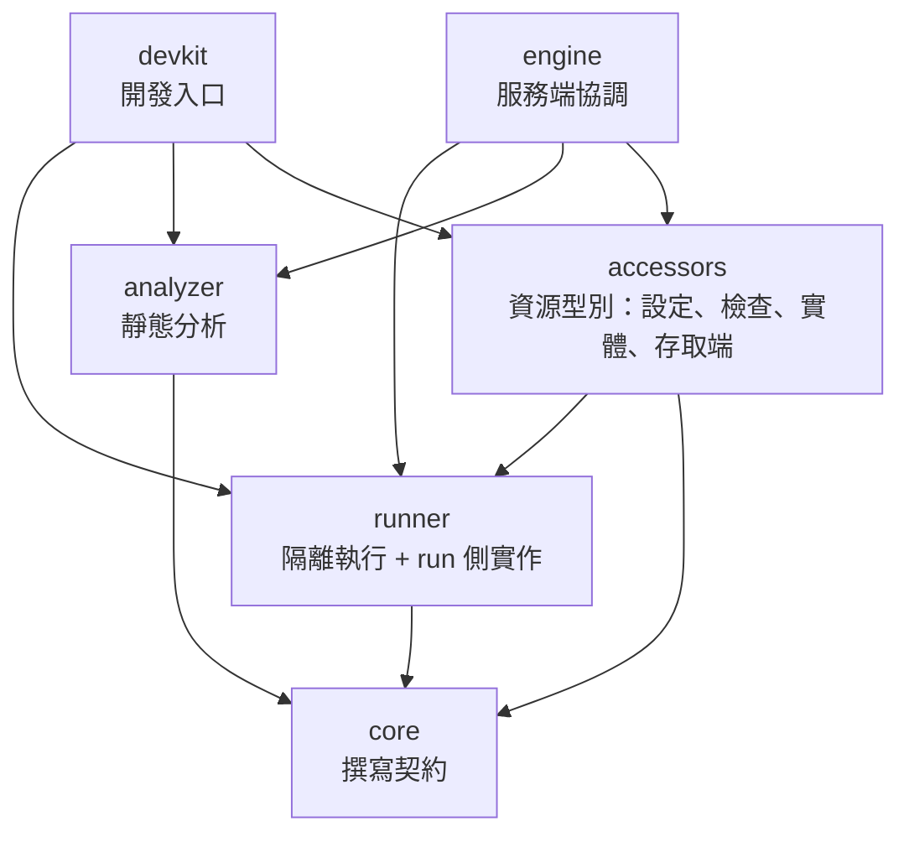

# 架構簡化與模組內聚（入口文件）

狀態：提案中（2026-10-30）。本頁回答：這次架構審閱發現什麼、建議怎麼調整、以什麼順序進行、細節在哪裡。修訂對象為 [pipeline-engine](../../stable/pipeline-engine/README.md) 的模組邊界；不改變任何對外行為、API、資料模型與部署形態。

## 目標與範圍

- 目標：降低修改一個關注點時需要跨越的模組與套件數量，讓每個模組只擁有一組內聚的責任。
- 前置：依童子軍原則，先結清 stable 文件與既有工作項中的未結事項（[00](00-open-items-closure.md)）。
- 範圍內：既有未結事項、Gradle 模組之間的責任分配、engine 內部的套件依賴方向、core 與 analyzer 的重複模型、根目錄 README 與 stable 文件的重複。
- 範圍外：新功能、API 與資料庫結構變更、部署拓撲、Console 前端結構、效能調校。

## 進行方式

- 核可：使用者在對話中明確確認即為核可。確認後架構師把提案寫入 stable、移除 draft 原檔，再依工作項總覽派工。
- 三個階段：**A 結清**（未結事項、測試衛生、既有驗收）→ **B 重整**（ADR-022 至 ADR-025）→ **C 收尾**（README 單一事實來源、全量驗證）。見[工作項總覽](work-items/README.md)。
- 每個工作項驗收通過後，架構師同一步更新 stable 的狀態欄與受影響的架構文件，不留到之後。

## 關鍵結論

| 主題 | 結論 | 詳見 | 狀態 |
|---|---|---|---|
| 未結事項 | 待確認問題依現行實作定案；測試暫存洩漏、WI-57 重新驗收與 WI-51 先完成；文件改寫為現況描述 | [00](00-open-items-closure.md) | 提案中 |
| 整體方向 | 維持現有 6 個 Gradle 模組，不拆不併；以「責任歸位」與「依賴單向」降低複雜度 | [03](03-options.md) | 提案中 |
| 資源型別 | 每個型別的設定驗證、正規化、描述、檢查與存取端建立集中在 accessors；engine 與 devkit 只做與型別無關的協調 | [ADR-022](adr/ADR-022-resource-type-ownership.md) | 提案中 |
| Engine 內部 | 依功能切片組織，每個功能擁有自己的路由、組態段、儲存與可觀測；功能之間依賴單向無循環，並由建置自動檢查 | [ADR-023](adr/ADR-023-engine-feature-slices.md) | 提案中 |
| core | 只保留 pipeline 撰寫契約；限制、錄製與存取端轉接等執行期實作移到 runner 的 run 側 | [ADR-024](adr/ADR-024-core-contract-only.md) | 提案中 |
| analyzer | 主程式可依賴 core 的 metadata 模型，刪除重複模型；位元組讀取仍只在 analyzer（修訂 WI-16 的依賴限制） | [ADR-025](adr/ADR-025-analyzer-shares-core-metadata.md) | 提案中 |

## 目標模組關係

與現況的差異只有兩條：analyzer 新增依賴 core（只用 metadata 模型）；engine 與 devkit 對 accessors 的使用改為與型別無關。

## 文件索引

| 章節 | 文件 | 狀態 |
|---|---|---|
| 0 既有未結事項結案清單 | [00-open-items-closure.md](00-open-items-closure.md) | 提案中 |
| 1 需求摘要 | [01-requirements.md](01-requirements.md) | 提案中 |
| 2 現況觀察（審閱發現） | [02-current-state.md](02-current-state.md) | 提案中 |
| 3 方案比較與推薦 | [03-options.md](03-options.md) | 提案中 |
| 4 部署架構 | 不適用：產物仍為 `engine.jar` 加 `run-runtime/`，run-runtime 仍只含 runner、core 與 Kotlin 標準函式庫（[04](../../stable/pipeline-engine/04-deployment.md)） | — |
| 5 IPC 模型 | 不適用：Engine 與 run 的邊界仍只傳 JDK 內建型別，HTTP API 不變（[05](../../stable/pipeline-engine/05-ipc.md)、[08](../../stable/pipeline-engine/08-api.md)） | — |
| 6 資料模型 | 不適用：資料庫結構與遷移不變（[06](../../stable/pipeline-engine/06-data-model.md)） | — |
| 7 非功能與風險 | [07-nfr-risks.md](07-nfr-risks.md) | 提案中 |
| 8 決策記錄 | [adr/](adr/)（ADR-022 至 ADR-025） | 提案中 |
| 9 工作項 | [work-items/README.md](work-items/README.md) | 提案中 |
