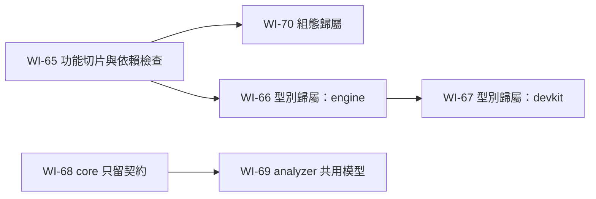

# 工作項總覽（架構簡化）

本文回答：架構簡化要交給 tdd-coder 的工作有哪些、先後順序為何。tdd-coder 只需讀本頁加被派到的那一項。狀態：提案中（2026-10-30）。編號接續 [pipeline-engine 工作項](../../../stable/pipeline-engine/work-items/README.md)。

| 項目 | 目標 | 相依 |
|---|---|---|
| [WI-65](WI-65-engine-feature-slices.md) | engine 依功能切片組織、消除功能間循環，並以建置檢查依賴方向 | 無 |
| [WI-70](WI-70-engine-config-per-feature.md) | engine 組態由各功能擁有自己的段落，組態基礎不依賴功能 | WI-65 |
| [WI-66](WI-66-resource-type-ownership-engine.md) | 資源型別知識集中到 accessors，engine 只做與型別無關的協調 | WI-65 |
| [WI-67](WI-67-resource-type-ownership-devkit.md) | devkit 使用 accessors 的同一份型別定義，與 engine 結果一致 | WI-66 |
| [WI-68](WI-68-core-contract-only.md) | core 只保留撰寫契約，執行期實作移到 runner | 無 |
| [WI-69](WI-69-analyzer-shares-core-metadata.md) | analyzer 共用 core 的 metadata 模型，刪除重複模型 | WI-68 |

兩條線互不相依；派工仍一次一項。建議順序：WI-65 → WI-70 → WI-66 → WI-67 → WI-68 → WI-69（先建立依賴檢查，後續搬移即受其保護）。

## 全域約束（適用本總覽所有項目）

- 沿用 [pipeline-engine 全域架構約束](../../../stable/pipeline-engine/work-items/README.md#全域架構約束適用所有項目)。
- **純結構調整，對外行為零變更**：HTTP API、錯誤代碼、回應格式、組態鍵與預設值、啟動失敗訊息、log 訊息、metric 與 span 的名稱與標籤、safe／unsafe 判定、run 結果皆不變。`ApiDocumentationTest` 通過。
- 既有測試全部通過，測試數量不減少（被合併的重複對照測試除外，須在回報中列出）；不在同一工作項中修改行為或修 bug，發現 bug 時回報。
- 資料庫結構與遷移不變；部署產物（`engine.jar`、`run-runtime/`）的組成不變；發佈建置位元組級可重現的保證維持。
- 不新增外部相依（依賴方向檢查若需要工具，先回報選項，不自行引入）。
- 完成時建置、全部測試（含 `:engine:packagedTest`）在 JDK 25 下通過，`ktfmtCheck` 通過。
