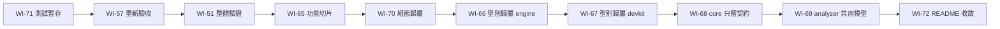

# 工作項總覽（架構簡化）

本文回答：架構簡化要交給 tdd-coder 的工作有哪些、先後順序為何。tdd-coder 只需讀本頁加被派到的那一項。狀態：提案中（2026-10-30）。編號接續 [pipeline-engine 工作項](../../../stable/pipeline-engine/work-items/README.md)。

## 順序

全部依序一次一項，前一項驗收通過、架構師更新完 stable 文件後才派下一項。

| 順序 | 階段 | 項目 | 目標 | 相依 |
|---|---|---|---|---|
| 1 | A 結清 | [WI-71](WI-71-test-temp-hygiene.md) | 測試不遺留暫存資料，全量 `check` 可無限次重複執行 | 無 |
| 2 | A 結清 | [WI-57](../../../stable/pipeline-engine/work-items/WI-57-test-environment-robustness.md)（既有） | 重新驗收：開發容器中全量 `check` 穩定通過 | WI-71 |
| 3 | A 結清 | [WI-51](../../../stable/pipeline-engine/work-items/WI-51-secret-non-leak-verification.md)（既有） | 型別化資源的機密不外洩與整體驗證 | WI-57 |
| 4 | B 重整 | [WI-65](WI-65-engine-feature-slices.md) | engine 依功能切片組織、消除功能間循環，並以建置檢查依賴方向 | WI-51 |
| 5 | B 重整 | [WI-70](WI-70-engine-config-per-feature.md) | engine 組態由各功能擁有自己的段落，組態基礎不依賴功能 | WI-65 |
| 6 | B 重整 | [WI-66](WI-66-resource-type-ownership-engine.md) | 資源型別知識集中到 accessors，engine 只做與型別無關的協調 | WI-70 |
| 7 | B 重整 | [WI-67](WI-67-resource-type-ownership-devkit.md) | devkit 使用 accessors 的同一份型別定義，與 engine 結果一致 | WI-66 |
| 8 | B 重整 | [WI-68](WI-68-core-contract-only.md) | core 只保留撰寫契約，執行期實作移到 runner | WI-67 |
| 9 | B 重整 | [WI-69](WI-69-analyzer-shares-core-metadata.md) | analyzer 共用 core 的 metadata 模型，刪除重複模型 | WI-68 |
| 10 | C 收尾 | [WI-72](WI-72-readme-single-source.md) | 根目錄 README 只留入門與連結，細節以 stable 文件為單一來源；全量最終驗證 | WI-69 |

架構師自己的工作（不派工）：階段 A 開始前執行 [00](../00-open-items-closure.md) 第一、三節的文件結案；每項驗收後更新 stable 狀態欄與受影響的架構文件。

## 全域約束（適用本總覽所有項目）

- 沿用 [pipeline-engine 全域架構約束](../../../stable/pipeline-engine/work-items/README.md#全域架構約束適用所有項目)。
- **童子軍原則**，每項完成時：
  - 碰過的檔案中沒有新增或殘留的 TODO、FIXME、被註解掉的程式碼、未使用的程式碼或相依、為除錯加的輸出。
  - 測試與建置不在儲存庫外留下暫存檔、容器或行程（WI-71 之後由其檢查涵蓋）。
  - 受影響的 README、`deploy/`、`dev/`、`release/` 與 `console/e2e/README.md` 在同一項內更新為現況；`docs/stable/`（含 [08-api](../../../stable/pipeline-engine/08-api.md)）由架構師更新，tdd-coder 在回報中列出需要更新之處。
  - 沒有新增跳過的測試；既有的跳過在回報中列出原因。
  - 發現範圍外的問題時不擱置、不以註記留下：在回報中描述，由架構師當場轉為工作項或在對話中結案。
- 階段 B 與 C 為**純結構調整，對外行為零變更**：HTTP API、錯誤代碼、回應格式、組態鍵與預設值、啟動失敗訊息、log 訊息、metric 與 span 的名稱與標籤、safe／unsafe 判定、run 結果皆不變。`ApiDocumentationTest` 通過。不在同一工作項中修改行為或修 bug，發現 bug 時回報。
- 既有測試全部通過，測試數量不減少（被合併的重複對照測試除外，須在回報中列出）。
- 資料庫結構與遷移不變；部署產物（`engine.jar`、`run-runtime/`）的組成不變；發佈建置位元組級可重現的保證維持。
- 不新增外部相依（若需要，先回報選項與代價，不自行引入）。
- 完成時建置、全部測試（含 `:engine:packagedTest`）在 JDK 25 下通過，`ktfmtCheck` 通過。
