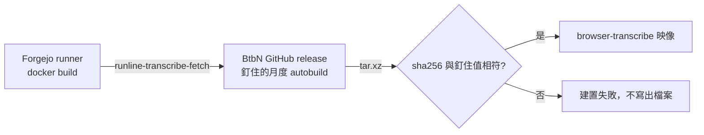

# ffmpeg-source：ffmpeg 靜態檔的下載來源

本主題回答：`browser-transcribe` 映像建置所需的 ffmpeg 與 ffprobe 從哪裡取得，以及如何固定。狀態：提案中。Issue：#35（工作項）、#36（ADR）。補充 [ADR-032](../../stable/homelab-arr/adr/ADR-032-pin-build-inputs-by-hash.md) 的固定方式，不修訂任何 stable 決策。

## 結論

- ffmpeg 與 ffprobe 的來源由 johnvansickle.com 改為 BtbN/FFmpeg-Builds 的 GitHub release；固定方式不變：版本與 sha256 只定義在 `deploy/bin/runline-transcribe-fetch` 一處，下載後先比對雜湊。
- 釘住 BtbN 的一個月度 autobuild 發佈標籤，不用滾動的 `latest`。
- 因為上游版本線改變（原為 7.0.2），換來源視為一次依賴升級，須重新通過 `runline-transcribe-check` 與既有測試才算完成。
- 其他輸入（silero-vad 模型、deep-filter、基底映像）不變。

## 元件關係

## 文件

| 文件 | 內容 | 狀態 |
|---|---|---|
| [ADR-36](adr/ADR-36-ffmpeg-source-btbn.md) | 來源選擇、取捨與後果 | 提案中 |
| [#35](work-items/35-ffmpeg-source.md) | 工作項：行為與驗收條件 | 提案中 |

## 待確認問題

1. BtbN 的哪一個月度 autobuild 與 ffmpeg 版本線（n7.1、n8.1 或 n9.0）可通過 `runline-transcribe-check` 與既有轉錄測試。影響：決定釘住的版本；由 #35 的驗證決定。
2. BtbN 發佈頁是否提供各檔的 sha256 清單。影響：有的話可與自行計算的值互相對照，沒有則維持 ADR-032 既有的「首次下載自行計算」限度。
3. v0.0.14 失敗的 run 是否保留。影響：新修復進 main 後以新 tag（例如 `v0.0.15`）重新打包；已推送的 `v0.0.14` 不刪不移。
