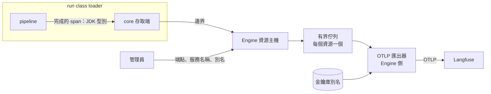

# trace-export：trace 匯出型別化資源

本主題回答：pipeline 如何送出 trace，而不持有匯出金鑰也不引用 OpenTelemetry。狀態：提案中（2026-10-27）。Issue：#46。來源：runline-transcribe 的 ADR-31。補充 [ADR-019](../../stable/pipeline-engine/adr/ADR-019-typed-shared-resources.md)，取代已作廢的 [run-otel](../../stable/run-otel/README.md)。

## 結論

- Engine 的封閉型別集合新增 `trace-export`：設定含匯出端點、服務名稱與一個金鑰庫別名；金鑰值只在金鑰庫。
- pipeline 經 core 契約提交「完成後的 span」，只含 JDK 內建型別；OpenTelemetry 與金鑰都留在 Engine。
- 每個資源一個匯出器與一個有界佇列；佇列滿或匯出失敗時丟棄、計數、警告，不阻塞也不使 run 失敗。
- 未綁定或停用時為空操作。金鑰輪替走金鑰庫重載。屬性內容不過濾，是否送出由管理員決定。

## 元件關係

## 文件

| 文件 | 內容 | 狀態 |
|---|---|---|
| [ADR-46](adr/ADR-46-trace-export-resource.md) | 方案比較、決策、取捨與後果 | 提案中 |

核可後再拆工作項（建議拆分：core 契約與 devkit 實作、Engine 型別與匯出器與緩衝、Console 表單與型別目錄、整體驗證），每項另開 Issue。

## 待確認問題

1. 此型別沒有容量與互斥語意，但 ADR-019 的資源模型含容量欄位與 run 級持有。影響：要決定是讓此型別忽略容量，還是以不限制的容量值表示；選擇會影響資源表單與持有者顯示。
2. 屬性數量與值長度的上限、佇列大小與沖出等待時間的預設值。影響：決定記憶體上限與 span 遺失的機率；建議由工作項依 OpenTelemetry 批次處理器的預設量級起訂，並可由部署組態調整。
3. 金鑰別名的機密是「整串認證值」還是「帳號與密碼兩段」。影響：Langfuse 目前使用 Basic 認證，單一別名放整串較簡單；ADR-019 的機密限可列印 ASCII，需確認整串值符合。
4. 一個 run 是否只允許一條 trace。影響：預設一條；若 pipeline 需要在同一個 run 開多條獨立 trace，契約需增加追蹤分組概念。
