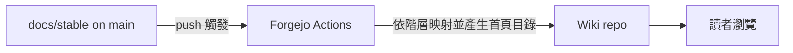

# wiki-mirror：Forgejo Wiki 作為 stable 文件映像

本主題回答：`docs/stable/` 如何自動呈現在 Forgejo Wiki，而 Wiki 不成為第二份事實來源。狀態：提案中。

## 目標與範圍

- 範圍內：`docs/stable/` 合併進 `main` 後，Wiki 自動更新為其映像，並有可瀏覽的首頁目錄。
- 範圍外：Wiki 的人工編輯、`docs/draft/` 的呈現、文件內容本身的改寫。

## 關鍵決策

| 項目 | 結論 | 細節 |
|---|---|---|
| Wiki 的角色 | `docs/stable/` 的唯讀映像，單向同步 | [#1](adr/1-wiki-is-readonly-mirror.md) |
| 觸發 | `main` 上 `docs/stable/` 有變動 | 同上 |
| 目錄結構對應 | 保留主題階層，不攤平 | 同上 |
| 實作 | Forgejo Actions 工作流與首頁目錄產生器，交給 tdd-coder | [工作項](work-items/README.md) |

## 元件關係

## 待確認問題

- Wiki 頁面名稱無法承載多層目錄時，採用哪種階層對應（路徑轉為頁名前綴，或建立子目錄）？影響連結改寫規則。
- 映像中 stable 內的相對連結是否需要改寫成 Wiki 連結？不改寫則文件間連結在 Wiki 失效。
- 被刪除或改名的 stable 檔案，Wiki 是否同步刪除？預設建議同步，使映像與 stable 一致。
- 同步所需的 Wiki 寫入憑證由誰提供、存放位置（Forgejo secrets）。
