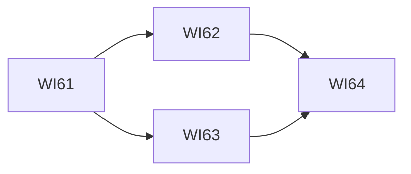

# Console 響應式版面工作項總覽

本文回答：Console 響應式版面要交給 tdd-coder 的工作有哪些、先後順序為何。tdd-coder 讀本頁加被派到的那一項。狀態：已核可（2026-10-13）。入口：[README](../README.md)。

| 項目 | 目標 | 相依 | 狀態 |
|---|---|---|---|
| [WI-61](WI-61-responsive-foundation.md) | 窄版面的基礎：斷點、抽屜導覽、頂列、觸控與輸入規則、手機尺寸的驗證基礎 | 無 | 已完成（2026-10-13），01b6130；WI-61 至 WI-64 合為一次提交，含 360、390、768px 全路由 e2e，驗收條件尚未由架構師逐條重跑 |
| [WI-62](WI-62-responsive-information-pages.md) | 查看資訊的頁面：run、log、pipeline、view、總覽 | WI-61 | 已完成（2026-10-13），01b6130；WI-61 至 WI-64 合為一次提交，含 360、390、768px 全路由 e2e，驗收條件尚未由架構師逐條重跑 |
| [WI-63](WI-63-responsive-admin-and-forms.md) | 管理頁、表單與對話框 | WI-61 | 已完成（2026-10-13），01b6130；WI-61 至 WI-64 合為一次提交，含 360、390、768px 全路由 e2e，驗收條件尚未由架構師逐條重跑 |
| [WI-64](WI-64-responsive-verification.md) | 全路由的手機尺寸驗證與文件 | WI-62、WI-63 | 已完成（2026-10-13），01b6130；WI-61 至 WI-64 合為一次提交，含 360、390、768px 全路由 e2e，驗收條件尚未由架構師逐條重跑 |

WI-62 與 WI-63 互不相依，但依單一派工原則，一次派一項（先 WI-62）。

## 全域架構約束

- 版面只有窄版面（寬度低於 768px）與寬版面兩種；寬版面的行為與外觀不變（[ADR-048](../adr/ADR-048-responsive-console.md)）。
- 只用同源的 `/api/v1`，不改變任何 API 契約，不修改 Engine（[ADR-015](../../pipeline-engine/adr/ADR-015-console-frontend.md)）。
- 沿用現有設計系統的 token；斷點只定義一次。
- 不可信內容維持既有的純文字呈現機制。
- 新增的文案走多語系機制，所有支援的語言都有。
- 既有 Console 測試與 e2e 必須全部通過；不得以放寬斷言達成。
- 測試不使用 Stub 或 Mock；遵循 TDD；專案沒有 CI，驗證皆可在本機完成。
