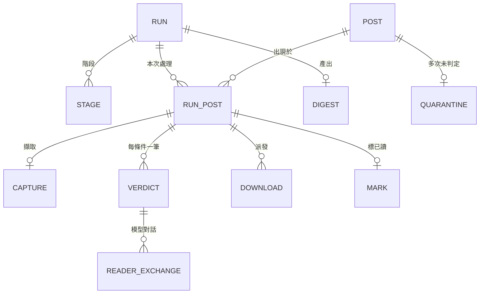

# 資料模型

本文回答：這條 pipeline 保存哪些資料、放在哪裡、如何彙整、生命週期為何。決策見 [ADR-024](adr/ADR-024-sqlite-run-store.md)。

## 原則

- pipeline 的所有寫入進同一個 SQLite 資料庫（經 `jdbc-pool` 資源，ADR-024）；不再寫任何檔案。
- 去重仍是 FreshRSS 的已讀狀態；資料庫是紀錄與彙整用，不取代它。
- 每筆紀錄可追溯到 run；run 記錄 pipeline 版本（內容雜湊）與判斷規則版本，使不同版本的結果可比較。
- 結構演進：前向、冪等，於 run 開始時套用，記錄結構版本；較新的資料庫遇到較舊的 pipeline 時拒絕寫入。

## 實體與關聯

| 實體 | 內容（要能回答的問題） |
|---|---|
| RUN | 何時開始與結束、結果（`success`、`failed`、`stopped`、`interrupted`，另以 `result_note` 說明原因；零篇、模型不可用等正常結果為 `success`）、參數（cap、條件 id、標已讀開關）、pipeline 版本、判斷規則版本、請求與實際回應的模型、最終計數 |
| STAGE | 每個階段的起迄、耗時、結果句 |
| POST | 跨 run 穩定的文章身分：FreshRSS 識別、url、標題、首次與最近一次看到的時間 |
| RUN_POST | 這次 run 抓到哪些未讀；順序；feed 內的 torrent／magnet；本次的最終處置（保留、過濾、被拒絕、未處理，以及未處理的原因：隔離、擷取失敗、文字不足、未被讀者處理） |
| CAPTURE | 站點 profile 與匹配方式、HTTP 狀態、文字（內容與字數）、封面種類與來源網址、封面影像、頁面找到的下載連結與其解析結果、錯誤、耗時 |
| VERDICT | 每個條件：原始分級、映射後 yes／no、套用的否決規則、引用的原文與是否通過驗證、被拒絕的原因 |
| READER_EXCHANGE | 完整的模型請求與回應文字（不含影像）、請求與回應的模型、thinking 開關、耗時、用量 |
| DOWNLOAD | 派給 rqbit 或 streamexa、種類（magnet、torrent、頁面網址）、目標、結果與狀態、嘗試次數、錯誤 |
| MARK | 哪些文章在本次被標為已讀、時間、成功或失敗；閘門關閉時沒有紀錄但 RUN 記錄原因 |
| DIGEST | 主題摘要、事實、完整 digest、檢查結果 |
| QUARANTINE | 連續未判定次數、隔離到期時間 |

## 額外收集

模型呼叫的耗時與用量、規則版本與模型的對應（比較準確度）、擷取耗時與失敗原因分布、站點 profile 命中率（找出該寫 profile 的站點）、每個階段耗時、標記結果。不收集機密、不收集 token。

## 生命週期

- 保留策略：判定、下載、標記、摘要等彙整用資料長期保留；體積大的原始資料（頁面文字、封面影像、模型對話）依天數清除，只保留摘要欄位與雜湊。天數為 pipeline 參數，預設 30 天。
- 清除在 run 開始時進行，失敗不使 run 失敗。
- 一致性：RUN 開始時建立、結束時補完；中途崩潰留下「未完成」的 RUN，下一次 run 開始時標記為中斷。寫入失敗時寧可少標已讀、不可多標。
- 多租戶：不適用。

## 存取

- 彙整：使用者在主機上以 SQLite 工具讀取資料庫檔，可與 run 同時讀取。
- 摘要交付：完整 digest 在 DIGEST，使用者以查詢取出；不提供檔案匯出。
