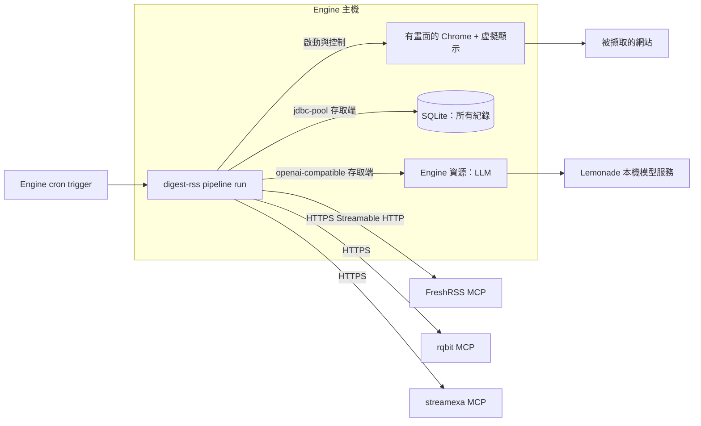

# digest-rss pipeline（入口文件）

狀態：已核可（2026-10-08）。本頁回答：把 pi-env 的 digest-rss 改成 runline pipeline 要做什麼、關鍵決策是什麼、細節在哪裡。

## 目標與範圍

- 把 pi-env 的 `video-page-summary` 技能中的正式流程（`rss-digest.sh` 串起的各階段）改寫為一個 runline pipeline，全部以 Kotlin 實作，**行為等價**；不再有 JavaScript 與 bash。
- 由 Engine 的 cron trigger 取代 pi 的 prompt 與 `digest` 容器的排程迴圈。
- 範圍外：評估與診斷輔助工具（`eval-reader`、`webgl-check`、`run-cleanup`、`digest-schedule`）、測試腳本本身（行為由新測試涵蓋）、pi 側舊檔的移除（由使用者自行處理）、提升模型判定準確度。

## 關鍵決策結論

| 主題 | 結論 | 詳見 |
|---|---|---|
| 瀏覽器擷取 | pipeline 在 Engine 主機上自行啟動有畫面的真實 Chrome 並以 DevTools 協定控制；因此是 unsafe pipeline，由管理員逐版本允許 | [ADR-022](adr/ADR-022-unsafe-pipeline-with-local-browser.md) |
| 外部服務憑證 | FreshRSS、rqbit、streamexa 的 token 存放在管理員維護的 `file` 資源內的憑證檔 | [ADR-023](adr/ADR-023-service-credentials.md) |
| 專案位置 | pipeline 是獨立於 runline 儲存庫的外部專案 `runline-digest-rss`（與 runline 同層），以 composite build 取得 devkit；只有 WI-1001、WI-1003、WI-1012、WI-1013 改動 runline 儲存庫 | [work-items/README.md](work-items/README.md) |
| LLM | 走 `openai-compatible` 資源（safe 路徑、機密在金鑰庫、容量 1 對應單一生成） | [05-ipc.md](05-ipc.md) |
| 資料保存 | pipeline 不寫檔，所有寫入進 SQLite：每次 run、每篇未讀、圖文判定、模型對話、下載派發、標記、摘要、隔離清單；Engine 為 `jdbc-pool` 新增 `sqlite` 資料庫種類 | [ADR-024](adr/ADR-024-sqlite-run-store.md)、[06-data-model.md](06-data-model.md) |
| 摘要交付 | 完整 digest 存在資料庫，以查詢取出 | [06-data-model.md](06-data-model.md) |
| 資源注入 | pipeline 以資源角色（名稱、型別、用途）宣告需求；開發人員與管理員在 pipeline 設定介面選擇注入哪個既有資源，未綁定時用同名資源 | [ADR-025](adr/ADR-025-resource-roles-and-binding.md) |

## 元件關係

## 文件索引

| 章節 | 文件 | 狀態 |
|---|---|---|
| 1 需求摘要 | [01-requirements.md](01-requirements.md) | 已核可 |
| 2 現況觀察 | [02-current-state.md](02-current-state.md) | 已核可 |
| 3 方案比較 | [03-options.md](03-options.md) | 已核可 |
| 4 部署架構 | [04-deployment.md](04-deployment.md) | 已核可 |
| 5 IPC 模型 | [05-ipc.md](05-ipc.md) | 已核可 |
| 6 資料模型 | [06-data-model.md](06-data-model.md) | 已核可 |
| 7 非功能與風險 | [07-nfr-risks.md](07-nfr-risks.md) | 已核可 |
| 8 決策記錄（ADR-022 至 025、028） | [adr/](adr/) | 已核可 |
| 9 工作項 | [work-items/README.md](work-items/README.md) | 已核可 |
| 上線手冊 | [runbook.md](runbook.md)（管理員的上線、第一次執行、查詢、維運與排錯） | 已核可 |

## 與 pipeline-engine 的關係

本專案使用既有機制：unsafe 逐版本允許（ADR-006）、白名單新增（ADR-002、ADR-014）、`openai-compatible`、`file` 與 `jdbc-pool` 資源（ADR-019）、cron trigger（ADR-005）。觸及 [pipeline-engine](../pipeline-engine/README.md) 的有三處：[WI-1003](work-items/WI-1003-sqlite-database-kind.md) 依 ADR-019 決策 7 的擴充方式，為 `jdbc-pool` 新增 `sqlite` 資料庫種類；[WI-1012](work-items/WI-1012-resource-roles-and-binding.md) 與 [WI-1013](work-items/WI-1013-console-resource-binding.md) 依 ADR-025 補充資源宣告為「角色與綁定」。皆不新增資源型別。Engine 主機需提供 Chrome 與虛擬顯示，屬部署項目（見 04）。
