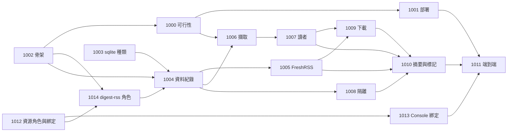

# digest-rss 工作項總覽

狀態：已核可（2026-10-08）。本文回答：要交給 tdd-coder 的工作有哪些、先後順序為何。tdd-coder 只需讀本頁加被派到的那一項，以及入口 [README](../README.md)。本專案的編號從 1000 起，與 pipeline-engine 的 WI-00 至 WI-58 分開。

行為參考來源（唯讀）：`/Users/lanyitin/Projects/Personal/pi-env/agent/skills/video-page-summary/`（腳本、`CAPTURE.md`、`criteria/`、`profiles/`）與 `docs/review-2026-09-28/regression-set/`（33 個標註案例）。這是行為的依據，不是要翻譯的程式碼。

儲存庫分工：WI-1001、WI-1003、WI-1012、WI-1013、WI-1015、WI-1016、WI-1020 改動 runline 儲存庫（Engine、devkit、Console、`deploy/`、開發腳本與文件）；其餘項目都在外部 pipeline 專案 `runline-digest-rss`（與 runline 同層的目錄）內。派工時須在回報要求中指明工作的儲存庫。

| 項目 | 目標 | 相依 | 狀態 |
|---|---|---|---|
| [WI-1000](WI-1000-browser-feasibility.md) | 可行性關卡：以 DevTools 協定從 JVM 驅動有畫面的 Chrome，通過目標站點並能乾淨結束 | WI-1002 | 條件通過（開發機與 Linux 容器已通過，軟體渲染下三類站點 15/15；目標主機以 pi-env 既有量測代替，殘餘風險由 WI-1011 驗證） |
| [WI-1001](WI-1001-engine-browser-deployment.md) | Docker 與 systemd 的 Engine 部署提供 Chrome、顯示、根憑證信任 | WI-1000 | 已實作（13 條中 11 條通過；第 8 條 pipeline 半部轉 WI-1006，第 10 條為文件；GPU 與 systemd 主機未驗證，步驟見 deploy/browser.md） |
| [WI-1002](WI-1002-pipeline-skeleton.md) | pipeline 專案骨架：宣告、參數、階段 log、結果語意、取消 | 無 | 已實作；IntelliJ 實測待使用者回報 |
| [WI-1003](WI-1003-sqlite-database-kind.md) | `jdbc-pool` 新增 `sqlite` 資料庫種類（Engine 與 devkit） | 無 | 已完成（12 條驗收通過；真實瀏覽器 e2e 91 通過、安全腳本 15 通過；amd64 原生程式庫與部署風險併入 WI-1001、WI-1011） |
| [WI-1015](WI-1015-dev-script-resource-root.md) | 開發腳本 `dev/dev.sh` 提供資源根目錄，使安全驗證腳本在乾淨環境可執行 | 無 | 已完成（乾淨 shell 下安全腳本 15 項與鎖檔檢查通過） |
| [WI-1012](WI-1012-resource-roles-and-binding.md) | 資源角色與綁定：pipeline 註記型別與用途，開發人員與管理員選擇注入的資源（Engine、core、devkit） | 無 | 已完成（綁定以上傳者加 pipeline 名稱為鍵；12 條驗收通過，含隔離測試；e2e 91、契約 113 通過） |
| [WI-1013](WI-1013-console-resource-binding.md) | Console 的 pipeline 資源綁定設定 | WI-1012、WI-1015 | 已完成（單元 1152、契約 132、e2e 96、安全腳本 15 通過；`dev/verify-console-security.sh` 需 node 24 在 PATH 前面） |
| [WI-1014](WI-1014-digest-rss-resource-roles.md) | digest-rss 以角色宣告三個資源並註記用途 | WI-1002、WI-1012 | 已完成（三個角色與用途；以真實 Engine 上傳並查詢驗證；本機 `dev/db.json` 改 SQLite 併入 WI-1004） |
| [WI-1004](WI-1004-run-store.md) | pipeline 的資料紀錄：結構、版本演進、run 與階段紀錄、保留清除 | WI-1002、WI-1003、WI-1014 | 已完成（81 個測試；真實 Engine 手動與 cron 共 5 次 run 成功；「某次 run 抓到哪些文章」的彙整驗證由 WI-1005 完成） |
| [WI-1005](WI-1005-freshrss-access.md) | FreshRSS 未讀取得、候選解析、標已讀；紀錄 RUN_POST 與 MARK | WI-1004 | 已完成（158 個測試；Fake 加 TLS；真實伺服器的契約測試尚待使用者以 `./gradlew realFreshRssTest` 執行，只讀） |
| [WI-1006](WI-1006-page-capture.md) | 頁面擷取：站點 profile、封面與文字、下載連結、worklist；紀錄 CAPTURE | WI-1000、WI-1004 | 已完成（304 個測試 macOS 真實 Chrome 通過；Linux 容器 82 個通過；真實站點的 profile 驗證留給 WI-1011） |
| [WI-1007](WI-1007-reader.md) | 讀者：條件規則、逐條件判定、映射與否決、引文驗證、模型身分、重試；紀錄 VERDICT 與 READER_EXCHANGE | WI-1004、WI-1006 | 已完成（443 個測試；參數修訂由 WI-1018 落實；標註案例實為 32 個；對真實模型未驗證，`realReaderTest` 待使用者在有 Lemonade 的環境執行，屬 WI-1017） |
| [WI-1008](WI-1008-quarantine.md) | 隔離清單（資料庫） | WI-1004 | 已完成（179 個測試；`recordOutcomes` 能力由 WI-1007 呼叫） |
| [WI-1009](WI-1009-downloads.md) | 保留文章的下載派發；紀錄 DOWNLOAD | WI-1005、WI-1006、WI-1007 | 已完成（505 個測試；真實 rqbit／streamexa 未驗證，`realDownloadsTest` 待使用者執行，只讀） |
| [WI-1010](WI-1010-digest-and-marking.md) | 事實、摘要、串接、檢查、可標已讀集合與標記閘門；紀錄 DIGEST | WI-1005、WI-1007、WI-1008、WI-1009 | 已完成（602 個測試；14 種閘門關閉條件各有零標記測試；對真實 Lemonade 與 FreshRSS 未驗證，摘要 thinking 關的預填待真實模型驗證） |
| [WI-1011](WI-1011-end-to-end-and-runbook.md) | 端到端行為等價驗證、彙整查詢驗證與管理員上線手冊 | WI-1001、WI-1010、WI-1013、WI-1018 | 已完成（618 個預設測試；端到端 41 個測試，約 21 個 run；手冊在 docs/draft/digest-rss/runbook.md 待晉升；文件不一致清單待處理；真實環境屬 WI-1017） |
| [WI-1016](WI-1016-sqlite-first-open-race.md) | SQLite 資料庫檔第一次開啟的競爭（Engine 側缺陷修正） | WI-1003 | 已完成（根因：WAL 切換回 `SQLITE_BUSY` 而不呼叫忙碌處理；以重試修正；完整 `ktfmtCheck test` 通過） |
| [WI-1017](WI-1017-first-real-run.md) | 真實環境的首次執行（由使用者執行；只讀契約檢查、真實模型、目標主機、`markRead=off` 的完整 run、決定是否開啟標記） | WI-1011、WI-1016 | 未開始 |
| [WI-1018](WI-1018-parameter-revision.md) | 落實參數修訂：`condition` 必填、請求模型 id 改為參數 `readerModel` | WI-1007、WI-1010 | 已完成（610 個測試；真實 Engine 驗證缺 `condition` 時平台以 422 `invalid_parameters` 拒絕建立 run；`condition=none` 時摘要的模型 id 處理由 WI-1019 落實） |
| [WI-1019](WI-1019-none-condition-summary.md) | `condition=none` 時摘要：有給 `readerModel` 就用於摘要，沒給只產出事實；手冊定稿 | WI-1018、WI-1011 | 已完成（`ktfmtCheck test` 與 `endToEndTest` 通過；新增 `summary_status` 值 `not_made`；手冊定稿） |
| [WI-1020](WI-1020-runline-doc-corrections.md) | runline 側文件更正（WI-48 末節、`deploy/browser.md`） | WI-1016、WI-1011 | 已完成（WI-48 末節與 `deploy/browser.md` 更正；`deploy/browser.md` 是未追蹤檔案，需納入提交） |
| [WI-1021](WI-1021-runbook-relocation.md) | 手冊由使用者搬到 stable 後，修正測試與連結的路徑 | WI-1019、使用者搬移手冊 | 已完成（`ktfmtCheck test` 通過；測試改讀新路徑，找不到手冊時明確失敗；舊路徑全專案搜尋無殘留） |

剩餘順序：WI-1019 → WI-1020 → 手冊晉升 → WI-1017（使用者執行），一次派一項。WI-1000 至 WI-1016、WI-1018 皆已完成（WI-1001 與 WI-1007 另有待辦的真實環境驗證，見各自狀態與 WI-1017）。

## 全域架構約束

- 全程 Kotlin，執行路徑不得有 Node 或 shell 腳本；不使用內含 Node 驅動的函式庫（[03](../03-options.md)）。
- pipeline 為 unsafe，其範圍限於 [ADR-022](../adr/ADR-022-unsafe-pipeline-with-local-browser.md) 所述：Chrome 與外部服務的 HTTP；LLM、檔案與資料庫必須走 context 與資源存取端。
- pipeline 不寫任何檔案；所有寫入進 SQLite（[ADR-024](../adr/ADR-024-sqlite-run-store.md)、[06](../06-data-model.md)）。
- pipeline 以資源角色宣告所需資源（名稱、型別、用途），實際資源由綁定決定（[ADR-025](../adr/ADR-025-resource-roles-and-binding.md)）。
- 外部服務位址與憑證來自組態與 [ADR-023](../adr/ADR-023-service-credentials.md)；機密不進 log、輸出、資料庫、metadata、trigger 參數。
- 標已讀不可逆：閘門在程式內；無摘要、無 url、標記開關非 `on`，一律零標記。
- 模型只回答判定與引文；url、標題、路徑、連結由程式組成。
- 測試的外部系統使用真實容器或自製簡易真實實作（Fake），不使用 Stub 或 Mock；專案沒有 CI，驗證皆可本機完成。
- 除 WI-1003、WI-1012、WI-1013 外，不改動 pipeline-engine 的任何決策與 API 契約。
