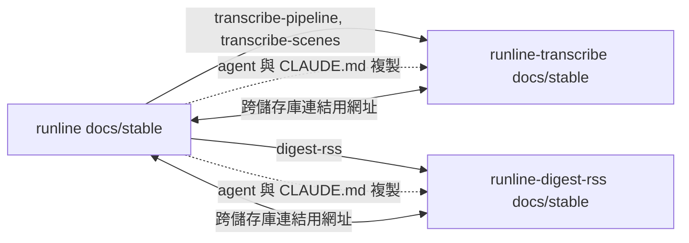

# docs-split：transcribe 與 digest-rss 文件拆到各自的專案儲存庫

本主題回答：哪些文件搬到哪個儲存庫、搬移後連結與編號如何處理，以及兩個接收專案如何取得相同的 agent 與開發流程。狀態：已核可。

## 目標與範圍

- 範圍內：`transcribe-pipeline`、`transcribe-scenes`（含 `docs/draft/transcribe-scenes`）搬到 `runline-transcribe`；`digest-rss` 搬到 `runline-digest-rss`；兩個專案複製 `high-level-architect`、`tdd-coder`、`CLAUDE.md` 與設定。
- 範圍外：文件內容的改寫（只改位置與連結）、搬移 git 歷史、兩個新儲存庫的 Wiki 映像、`pipeline-engine` 等其他主題。

## 關鍵決策

| 項目 | 結論 | 細節 |
|---|---|---|
| 搬移與留存 | 三個主題搬走，其餘主題留在 runline；搬走後 runline 不保留副本 | [#13](adr/13-docs-split.md)（已核可） |
| 連結 | 儲存庫內保持相對連結，跨儲存庫改為指向 `main` 的網址 | 同上 |
| 編號 | 既有 WI-／ADR- 編號凍結；新項目用各儲存庫自己的 Issue 編號 | 同上 |
| 流程與 agent | 兩專案沿用 draft／stable 分工與立項查重流程，agent 與 `CLAUDE.md` 原樣複製 | 同上 |
| 實作 | 兩個接收專案可並行，runline 清理最後做 | [工作項](work-items/README.md)（已核可） |

## 元件關係

## 待確認問題

- `runline-transcribe/docs/` 已有 `feasibility-report.md` 與 `test-feedback-report.md`，不屬於 stable。預設維持原位不動；要不要納入 stable 或 draft，需要確認。
- 兩個接收專案的 Forgejo 儲存庫是否已有 `in-progress` 標籤？沒有時，需要先建立（含帳號指派的前提）。
- 原樣複製的 agent 定義內容描述的是 runline 的 Kotlin 多模組結構，未必符合兩個接收專案；本次不改，是否另案調整。
