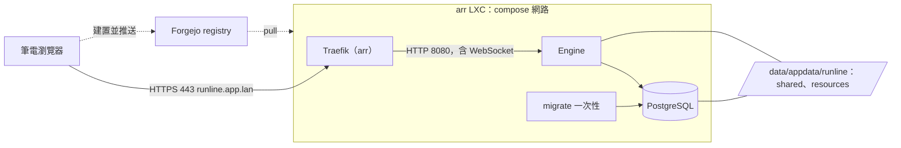

# homelab arr 部署（入口文件）

狀態：已核可（2026-10-09）。本頁回答：runline 如何部署到 homelab 的 arr LXC，並讓筆電以 `https://runline.app.lan` 使用；關鍵決策與細節在哪裡。

## 目標與範圍

- 目標：Engine、PostgreSQL 與 Console 在 arr 上運作，筆電瀏覽器以 `https://runline.app.lan` 開啟 Console 並呼叫 API。
- 範圍內：映像檔的建置與發佈路徑、arr 上的服務拓撲、路由與 TLS、持久資料的位置與備份、密鑰來源。
- 範圍外：Terraform／Incus／Traefik／DNS 的實際變更（由 homelab-deployer 在 homelab 的基礎設施儲存庫執行）、多實例、digest-rss 的上線（見其 [runbook](../digest-rss/runbook.md)）。

## 關鍵決策結論

| 主題 | 結論 | 詳見 |
|---|---|---|
| 部署形態 | arr 既有的 Docker Compose 管理面內新增 postgres、一次性 migrate、engine 三個服務；沿用 runline 的 Docker 部署設計，不採 systemd | [ADR-026](adr/ADR-026-homelab-arr-deployment.md) |
| 映像檔 | 瀏覽器版（digest-rss 需要），在筆電交叉建置為 `linux/amd64`，推到 Forgejo registry（`forgejo.dev.lan`）；arr 只 pull，不建置 | ADR-026 |
| 入口與 TLS | arr 內既有 Traefik 以主機名稱 `runline.app.lan` 路由到 engine 的 8080；憑證由 step-ca 簽發；engine 不發布到宿主 | [04-deployment.md](04-deployment.md) |
| 資料 | 全新 instance；postgres 容器與三個持久目錄（postgres-data、shared、resources）由 compose 定義，放在 arr 的 `/data/appdata/runline/`；首版不做備份 | 04-deployment.md |
| 密鑰 | 以 fnox（age 加密）→ `TF_VAR_*` 提供 | 04-deployment.md |

## 元件關係

## 文件索引

| 章節 | 文件 | 狀態 |
|---|---|---|
| 4 部署架構 | [04-deployment.md](04-deployment.md) | 已核可 |
| 8 決策記錄 | [adr/ADR-026-homelab-arr-deployment.md](adr/ADR-026-homelab-arr-deployment.md) | 已核可 |
| 8 決策記錄（續） | [adr/ADR-027-forgejo-action-image-publishing.md](adr/ADR-027-forgejo-action-image-publishing.md)：推 `v*` tag 時由 Forgejo Action 建置並推送，上線手動 | 已核可 |
| 8 決策記錄（續） | [adr/ADR-029-pin-build-inputs-by-hash.md](adr/ADR-029-pin-build-inputs-by-hash.md)：action 與容器映像以內容雜湊固定，更新為人工動作 | 已核可 |
| 9 工作項 | [work-items/README.md](work-items/README.md) | 已核可 |

第 1、2、3、5、6、7 章不另立文件：需求與現況在 ADR-026 的背景與 04 中；IPC 與資料模型沿用 [pipeline-engine](../pipeline-engine/README.md)，不變。

## 與 pipeline-engine 的關係

沿用 [04-deployment.md](../pipeline-engine/04-deployment.md) 與 [Docker 指南](../pipeline-engine/04-deployment-docker.md)，無衝突；新增的是「由 registry pull 映像檔」這條 pipeline-engine 沒有描述的路徑。

## 待確認問題

已決定：首版不備份、全新 instance；密鑰用 fnox；瀏覽器版映像檔；筆電交叉建置；Forgejo registry 可推可拉；arr 為 amd64；根憑證與 GPU 的取得方式見 [04](04-deployment.md)。備份何時處理留待日後。Engine 容器不設 CPU 與記憶體上限。

| # | 問題 | 影響 |
|---|---|---|
| Q12 | GPU 是否真的提供硬體加速（2026-08 曾驗證 arr 內沒有） | 不阻擋；部署後以探測實測，結果決定要不要啟用 `CHROME_REQUIRE_HARDWARE_RENDERING` |
