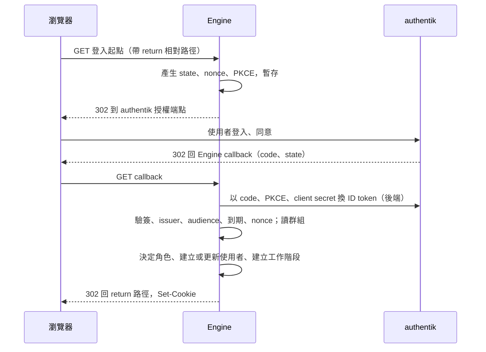

# IPC 與認證契約

本文回答：瀏覽器、Engine、authentik 之間誰呼叫誰、傳什麼語意的資料；API 如何同時接受 Bearer 與工作階段。

## 登入流程

## 端點（語意層級；詳細契約於實作時寫入 08-api）

| 端點 | 認證 | 語意 |
|---|---|---|
| 登入方式查詢 | 免 | 只回報是否啟用 OIDC；供登入頁決定是否顯示按鈕 |
| 登入起點 | 免 | 開始流程，導向 authentik；`return` 只接受本站相對路徑，其他一律忽略；OIDC 未啟用回 404；登入過多與 authentik 不可用導回 Console 登入頁並帶 `login_error`（`too_many_logins`、`provider_unavailable`），見 [ADR-031](adr/ADR-031-console-contract-alignment.md) |
| callback | 免（以 state 證明） | 完成流程；成功導回；失敗導回 Console 的登入頁並帶穩定的錯誤代碼 |
| 工作階段查詢 | 工作階段 | 回傳名稱、角色、顯示名稱、CSRF token；無效回 401 |
| 登出 | 工作階段加 CSRF | 刪除工作階段並清除 cookie；無工作階段也回成功（冪等） |
| 使用者列表與查詢 | Bearer 或工作階段（admin） | 名稱、顯示名稱、停用狀態、最近登入、目前工作階段數 |
| 停用／啟用使用者 | admin | 停用：立即刪除該使用者所有工作階段，並拒絕其登入直到啟用；啟用：恢復登入資格；記錄操作者 |
| 工作階段列表與結束 | admin | 列出某使用者的工作階段（建立與最近使用時間，不含識別碼）；結束單一或全部 |

停用只針對 OIDC 使用者；對 `API_TOKENS` 的名稱回錯誤。被停用者的下一個請求得到 401，登入時得到 `user_disabled`。

## 重新驗證（Engine 對 authentik）

- 工作階段被使用且距上次成功驗證超過間隔時，Engine 先以 refresh token 向 authentik 換新的 ID token 再處理請求；同一工作階段並行請求只換一次。
- 結果：仍屬於允許群組 → 更新角色（可能改變）並放行；不再屬於、使用者被停用或 refresh 被拒 → 刪除工作階段，回 401；authentik 無法連線 → 寬限時間內放行，超過則失效。
- Refresh token 若被輪替，保存新的；換 token 失敗不重試同一個已使用的 token。

callback 的失敗代碼至少區分：被管理員停用（`user_disabled`）、使用者在 authentik 拒絕或取消、state 無效或逾時、驗證 ID token 失敗、不屬於任何允許群組（`not_authorized`）、名稱衝突（`name_conflict`）、authentik 不可用。錯誤不暴露 token、群組清單以外的內部細節；log 記錄原因類別與使用者名稱，不記錄 token。

## 雙認證語意

- 請求帶 `Authorization` 標頭：只依 Bearer 判斷，無效即 401，不退而看 cookie。
- 沒有該標頭：依工作階段 cookie。兩者皆無或無效：401。
- 兩種來源得到同樣的「名稱與角色」，所有授權、可見範圍、擁有權、稽核欄位與 [ADR-020](../pipeline-engine/adr/ADR-020-per-uploader-artifact-versions.md) 規則不分來源。
- 工作階段認證下，POST、PUT、PATCH、DELETE 須帶 CSRF token（標頭）且 `Origin` 與對外網址同源，否則 403；Bearer 請求不受此限。GET 不得改變狀態。
- 工作階段 cookie 不可用於 Webhook 入口、WebSocket log 串流與免認證端點以外的任何特殊用途；WebSocket 串流維持只接受 Bearer。
- `GET /api/v1/system` 的呼叫者資訊另標示認證來源（token 或 oidc）。

## 逾時、重試與錯誤

- 對 authentik 的 HTTPS 呼叫（探索、金鑰、換 token）有連線與總逾時，不自動重試換 token（授權碼只能用一次）；探索與金鑰取得失敗於下次登入重試。
- 登入進行中的暫存有短效期限（分鐘級），逾時的 callback 以 `state` 無效處理。
- 同一個 callback 重送：授權碼已用過，回失敗，不建立第二個工作階段。

## 版本演進

新增端點與欄位，不改現有 Bearer 契約；ADR-012 的免認證清單新增登入方式查詢、登入起點、callback。
