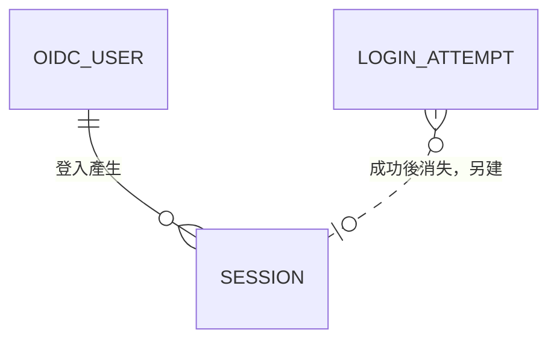

# 資料模型

本文回答：OIDC 登入需要保存哪些資料、關聯與生命週期為何。

| 實體 | 內容 | 規則 |
|---|---|---|
| OIDC User | issuer、subject、runline 名稱、顯示名稱、停用狀態（含設定者與時間）、建立時間、最近登入時間 | （issuer，subject）唯一；名稱唯一且建立後不變；名稱不得等於 `API_TOKENS` 的名稱；不保存密碼、email、token、群組；不因 authentik 改名或移出群組而刪除 |
| Session | 識別碼的雜湊、使用者、目前的角色、CSRF token、加密的 refresh token、建立時間、最近使用時間、最近成功驗證時間、到期時間 | 識別碼不可逆保存；refresh token 只以加密形式保存，金鑰不在資料庫；到期、登出、被撤銷或使用者被停用即刪除 |
| Login Attempt | state、nonce、PKCE 驗證碼、返回路徑、建立時間 | 短效（分鐘級）、單次使用、callback 處理後刪除 |

## 一致性與交易

- 停用使用者與刪除其所有工作階段在同一交易；停用後並行完成的登入或重新驗證不得建立或保留工作階段。
- 首次登入建立使用者與工作階段在同一交易；名稱唯一性由資料庫保證，並行首次登入以失敗的一方回名稱衝突處理。
- Login Attempt 的消耗（讀取並刪除）是原子的，使同一 state 只能成功一次。

## 生命週期

- 過期的 Session 與 Login Attempt 由既有的保留清理機制移除（沿用 [README 的保留清理](../../../README.md) 的批次、間隔與不重疊原則），有各自的有效期限判斷，不依賴清理才失效。
- OIDC User 不自動刪除；移除名稱佔用須由管理員處理（尚未設計，列入待確認，影響：離職者名稱的釋放）。
- 擁有權資料（上傳者、綁定等）仍以名稱保存，不引用使用者表，故 token 與 OIDC 兩種來源共用同一套名稱語意。

## 遷移與隔離

- 遷移由既有的一次性 `migrate` 程序執行，Engine 只檢查版本；不需要轉換既有資料。
- 單一組織、無多租戶。
