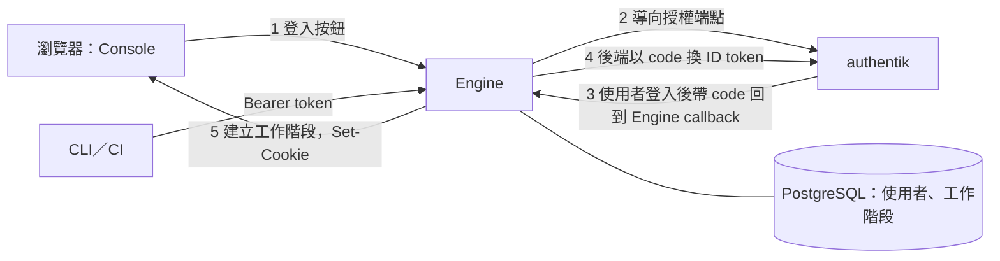

# OIDC 登入（入口文件）

狀態：已核可（2026-10-10）。本頁回答：用 authentik 以 OIDC 登入 runline 要做什麼、關鍵決策是什麼、細節在哪裡。

## 目標與範圍

- 人在 Console 按「使用 authentik 登入」，由 Engine 自己完成 OIDC 登入（Engine 是 OIDC client），作法同 Forgejo。
- 角色由 authentik 的群組決定：在 `runline-admin` 的人是管理員，在 `runline-developer` 的人是開發人員，兩者都不在的人不能使用。
- 範圍外：Engine 不管理密碼與使用者的帳號生命週期（建立、停用、改密碼都在 authentik）；不做 authentik 以外的 OIDC 提供者的專屬支援（標準 OIDC 即可，但只驗證 authentik）；不做 SAML；不做機器對機器的 OIDC（CLI／CI 沿用 `API_TOKENS`）。

## 關鍵決策結論

| 主題 | 結論 | 詳見 |
|---|---|---|
| 登入方式 | Engine 當 OIDC client（Authorization Code + PKCE，機密 client），登入後以伺服器端工作階段與 HttpOnly cookie 維持登入 | [ADR-029](adr/ADR-029-oidc-login-with-server-session.md) |
| 角色 | 登入時依群組 claim 決定；admin 群組優先於 developer 群組；兩者都不在則拒絕登入且不建立工作階段 | [ADR-029](adr/ADR-029-oidc-login-with-server-session.md) |
| 身分名稱 | 首次登入時以 authentik 的 username 建立 runline 內的名稱，之後固定不變；名稱與 `API_TOKENS` 的名稱不可重複 | [ADR-029](adr/ADR-029-oidc-login-with-server-session.md) |
| 立刻踢人 | Engine 每隔約 60 秒（可設）以 refresh token 向 authentik 重新驗證使用中的工作階段，收回權限即刪除；管理員也能在 runline 停用使用者，立即生效 | [ADR-029](adr/ADR-029-oidc-login-with-server-session.md) |
| 與 token 並存 | `API_TOKENS` 與 Bearer 保留，給 CLI、CI 與機器使用；瀏覽器的人走 OIDC | [05-ipc.md](05-ipc.md) |
| 登入的前提 | ID token 只接受非對稱簽章；沒有 refresh token 就拒絕登入；待處理的登入暫存有上限 | [ADR-030](adr/ADR-030-signing-and-refresh-token-requirements.md) |
| 取代的現行決策 | 取代 ADR-017 對 cookie 工作階段的否決，並修訂 ADR-012 的認證範圍與免認證清單 | [ADR-029](adr/ADR-029-oidc-login-with-server-session.md) |

## 元件關係

## 文件索引

| 文件 | 回答的問題 | 狀態 |
|---|---|---|
| [01-requirements.md](01-requirements.md) | 需求、現況、假設與待確認問題 | 已核可 |
| [03-options.md](03-options.md) | 方案比較與推薦 | 已核可 |
| [adr/ADR-029-oidc-login-with-server-session.md](adr/ADR-029-oidc-login-with-server-session.md) | 決策與取捨 | 已核可 |
| [adr/ADR-030-signing-and-refresh-token-requirements.md](adr/ADR-030-signing-and-refresh-token-requirements.md) | 簽章、refresh token 與登入暫存上限的前提；修訂 ADR-029 決策 1 與 9 | 已核可 |
| [adr/ADR-031-console-contract-alignment.md](adr/ADR-031-console-contract-alignment.md) | Console 與 Engine 的登入契約對齊：按鈕名稱、登入起點失敗導向、e2e 分離 | 已核可 |
| [04-deployment.md](04-deployment.md) | 設定、authentik 端需求、網路與密鑰 | 已核可 |
| [05-ipc.md](05-ipc.md) | 登入流程、端點、cookie、CSRF、雙認證語意 | 已核可 |
| [06-data-model.md](06-data-model.md) | 使用者與工作階段資料 | 已核可 |
| [07-nfr-risks.md](07-nfr-risks.md) | 非功能性考量與風險 | 已核可 |
| [work-items/README.md](work-items/README.md) | 交給 tdd-coder 的工作項與相依順序 | 已核可 |

`docs/stable/pipeline-engine/` 的 ADR-012、ADR-017、`05-ipc.md`、`06-data-model.md`、`08-api.md`、`04-deployment.md` 與 `README.md` 的相關描述，由各工作項的驗收條件負責更新；在工作項完成前，這些文件仍描述現行行為。
