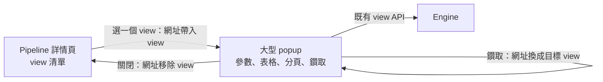

# pipeline-view-popup：pipeline view 以大型 popup 呈現

本主題回答：Console 的 pipeline view（資料區）如何擁有足夠的顯示面積。狀態：已核可（2026-10-19）。Issue：#29。補充 [ADR-033](../pipeline-views/adr/ADR-033-pipeline-views.md) 與 [WI-1302](../pipeline-views/work-items/WI-1302-console-views.md) 的呈現方式，不修訂任何 stable 決策。

## 結論

- 詳情頁的「資料」區只保留 view 清單；選一個 view 才開啟約 95% viewport 的 popup，參數輸入、表格、分頁與鑽取都在 popup 內。
- popup 的開關由網址決定：網址帶有 view 即開，沒有即關。view、參數值與頁碼仍記在網址，重新整理、分享連結與瀏覽器上一頁的行為不變。
- 鑽取在同一個 popup 內換成目標 view，沿用既有的「返回」與保留原參數、頁碼。
- 窄版面（768px 以下，ADR-048）popup 改為全螢幕。
- 不新增路由、不新增頂層導覽、不改 API。

## 元件關係

## 方案比較

| 選項 | 優點 | 缺點 |
|---|---|---|
| 採用：網址驅動的 95% popup | 符合需求；保留詳情頁脈絡；沿用既有網址狀態與 Console 的對話框機制；無新路由 | 開啟期間背景不可捲動；popup 內的焦點、Esc 與鑽取需一併處理好 |
| 每個 view 獨立整頁路由 | 空間最大；無 modal 負擔 | 新增子路由，改動導覽結構；離開詳情頁脈絡 |
| 卡片內「展開」切換 | 改動最小 | 仍是同一容器，捲動與可及性容易出問題 |

## 文件

| 主題 | 文件 | 狀態 |
|---|---|---|
| 工作項 #29：view 的大型 popup 呈現 | [work-items/29-view-popup.md](work-items/29-view-popup.md) | 已核可 |

## 範圍

- 範圍內：view 區塊的呈現容器、開關行為、窄版面行為。
- 範圍外：view 的宣告、API、欄位呈現規則、錯誤文案（沿用 WI-1302）；「在獨立頁開啟」的連結（見待確認問題）。

## 待確認問題

- 是否之後需要「在獨立頁開啟」以便長時間觀察？不在本項範圍；若需要，另立項目，影響是新增子路由。
