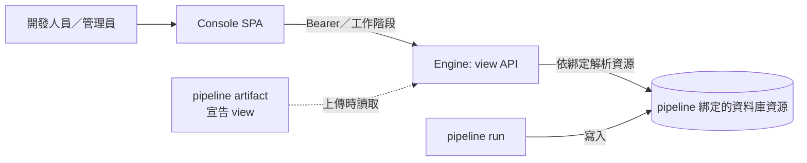

# Pipeline view：讓每個 pipeline 在 Console 顯示自己的資料

本文回答：pipeline 如何在 Console 顯示自己累積的資料（第一個使用者是 digest-rss 的「下載了哪些、沒下載的原因」）。狀態：已核可（2026-10-11）。

## 結論

- pipeline 在 artifact 的宣告式 metadata 中列出若干「view」：具名、唯讀、有欄位定義的查詢，掛在它已宣告的資料庫資源角色上。
- Engine 以該角色綁定的資源執行查詢，提供唯讀 API；Console 在 pipeline 詳情頁用通用的表格呈現。pipeline 不攜帶任何前端程式碼。
- 第一版只做「清單加處置與原因」：表格、參數篩選、列到另一個 view 的鑽取；不做圖表、明細頁、影像。
- 開發人員（自己上傳的 pipeline）與管理員（全部）都能看。

## 元件關係

## 文件

| 主題 | 文件 | 狀態 |
|---|---|---|
| 需求、假設、待確認問題 | [01-requirements.md](01-requirements.md) | 已核可 |
| 決策（方案比較、view 宣告、唯讀與隔離） | [ADR-033](adr/ADR-033-pipeline-views.md) | 已核可 |
| 決策：參數以具名佔位符綁定 | [ADR-034](adr/ADR-034-view-parameter-binding.md) | 已核可 |
| 決策：讀取逾時與並行上限 | [ADR-035](adr/ADR-035-view-read-limits.md) | 已核可 |
| 通訊契約（API、錯誤、分頁、鑽取） | [05-ipc.md](05-ipc.md) | 已核可 |
| 非功能與風險 | [07-nfr-risks.md](07-nfr-risks.md) | 已核可 |
| 工作項總覽 | [work-items/README.md](work-items/README.md) | 已核可 |

## 不適用的章節

- 現況觀察：寫在 ADR-033 的背景。
- 部署架構：不適用。不新增行程、容器或組態；仍是「一個 Engine 加一個 PostgreSQL」，Console 隨 Engine 發佈（ADR-015）。
- 資料模型：不適用於 Engine。Engine 不保存 view 的結果；宣告隨 artifact 的 metadata 保存（ADR-003）。digest-rss 的資料模型見 `https://forgejo.dev.lan/runline/runline-digest-rss/src/branch/main/docs/stable/digest-rss/06-data-model.md`，view 不改動它的實體；WI-1303 僅新增一個索引（資料庫結構版本 8）。
