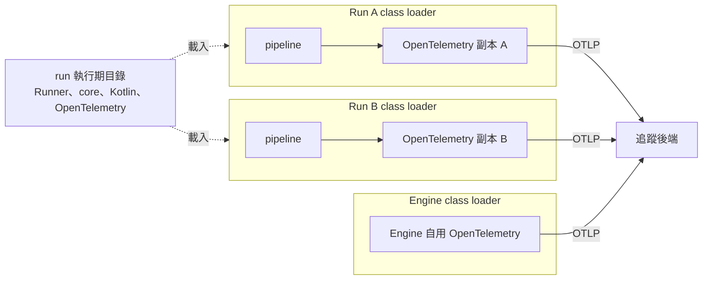

# run-otel：run 類別載入器提供 OpenTelemetry

本主題回答：pipeline 要在 run 內使用 OpenTelemetry（trace 匯出）時，Runner 提供什麼、版本誰決定、run 之間如何隔離。狀態：已核可（2026-10-27）。Issue：#42（ADR）、#43（工作項）。來源：runline-transcribe 的 ADR-23（該儲存庫 Issue #23，已核可）。修訂 [ADR-001](../pipeline-engine/adr/ADR-001-isolated-classloader.md) 中「run 的 class loader 只含 Runner、core 與 Kotlin 標準函式庫」的內容；隔離原則本身不變。

## 結論

- 每個 run 的 class loader 額外提供 OpenTelemetry 的 API、SDK、OTLP 匯出與語意慣例函式庫，來源是 run 執行期目錄，與 Engine 自己使用的 OpenTelemetry 分屬不同 class loader。
- 版本由 Runner 決定，並公告於 [runner-libraries](runner-libraries.md)（單一事實來源）。run 內提供的版本與 Engine 自用的版本分開管理。
- 全域狀態屬於各 run 自己的 class loader，因此 run 之間、run 與 Engine 之間互不影響。
- pipeline jar 內夾帶的 OpenTelemetry 類別以 Runner 提供的為準，並以警告告知；不拒絕。
- Engine 與 run 的邊界仍只傳 JDK 內建型別，不傳 OpenTelemetry 型別。

## 元件關係

## 文件

| 文件 | 內容 | 狀態 |
|---|---|---|
| [ADR-42](adr/ADR-42-run-provides-opentelemetry.md) | 選項、決策、取捨與後果 | 已核可 |
| [runner-libraries](runner-libraries.md) | Runner 提供的函式庫與版本（公告） | 已核可 |
| [#43](work-items/43-run-provides-opentelemetry.md) | 工作項：行為與驗收條件 | 已核可，待派工 |

## 待確認問題

1. 夾帶 OpenTelemetry 類別的警告要出現在哪裡。影響：預設為上傳結果與該 run 的 log 各一次；若只想要其一，工作項的驗收條件需調整。
2. pipeline 使用 OpenTelemetry 類別時，靜態分析的 safe／unsafe 判定是否需要白名單項目。影響：未列入白名單則該 pipeline 判為 unsafe，需管理員逐 pipeline 開啟；是否預設放行由使用者決定。
3. 開發入口（devkit）是否同樣提供這組函式庫。影響：ADR-001 規定開發入口與 Engine 共用同一份 Runner 執行路徑，本主題預設兩者行為一致。
