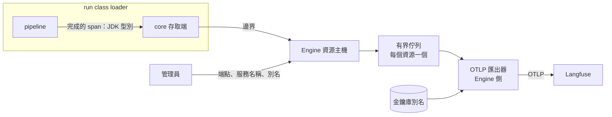

# trace-export：trace 匯出型別化資源

本主題回答：pipeline 如何送出 trace，而不持有匯出金鑰也不引用 OpenTelemetry。狀態：已核可（2026-10-27）。Issue：#46。來源：runline-transcribe 的 ADR-31。補充 [ADR-019](../pipeline-engine/adr/ADR-019-typed-shared-resources.md)，取代已作廢的 [run-otel](../run-otel/README.md)。

## 結論

- Engine 的封閉型別集合新增 `trace-export`：設定含匯出端點、服務名稱與一個金鑰庫別名；金鑰值只在金鑰庫。
- pipeline 經 core 契約提交「完成後的 span」，只含 JDK 內建型別；OpenTelemetry 與金鑰都留在 Engine。
- 每個資源一個匯出器與一個有界佇列；佇列滿或匯出失敗時丟棄、計數、警告，不阻塞也不使 run 失敗。
- 未綁定或停用時為空操作。金鑰輪替走金鑰庫重載。屬性內容不過濾，是否送出由管理員決定。
- 金鑰別名放整串認證值；容量設為接近無限的固定值；一個 run 一條 trace。

## 元件關係

## 文件

| 文件 | 內容 | 狀態 |
|---|---|---|
| [ADR-46](adr/ADR-46-trace-export-resource.md) | 方案比較、決策、取捨與後果 | 已核可 |

工作項（Issue 編號即工作項編號；詳細文件核可前在 `docs/draft/trace-export/work-items/`）：

| 項目 | 目標 | 相依 | 狀態 |
|---|---|---|---|
| #50 A | core span 契約與 devkit 實作 | 無 | 提案中 |
| #51 B | Engine 型別、匯出器與緩衝 | #50 | 提案中 |
| #52 C | Console 與型別目錄 | #51 | 提案中 |
| #53 D | 整體驗證 | #50、#51、#52 | 提案中 |

順序：#50 → #51 → #52 → #53，一次派一項。

## 待確認問題

1. 金鑰別名的整串認證值是否全為可列印 ASCII。影響：ADR-019 的機密限可列印 ASCII；Langfuse 的 Basic 認證值為 base64 字串，預期符合，由 #51 以真實金鑰庫驗證。
2. 接近無限的固定容量值與持有者顯示方式。影響：由 #51 與 #52 定義，不影響契約。
