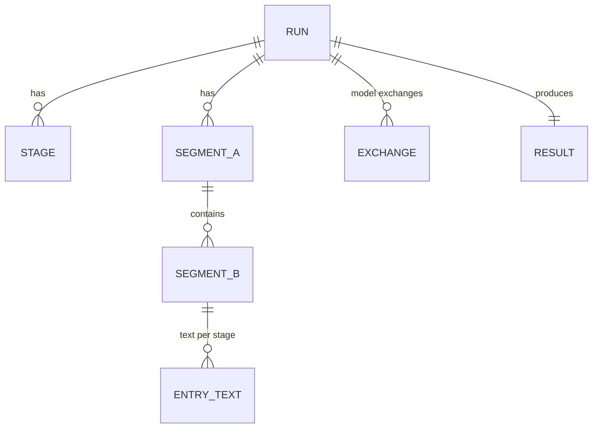

# 6 資料模型

狀態：已核可（2026-10-11）。本文回答：資料庫存什麼、實體如何關聯、保留多久。

## 選型

SQLite（`jdbc-pool` 的 `sqlite` 種類），理由同 [digest-rss ADR-024](../digest-rss/adr/ADR-024-sqlite-run-store.md)：單機、單寫入、免外部資料庫。

## 實體

| 實體 | 內容 |
|---|---|
| RUN | 資料庫指派的識別、相對檔名、開始與結束、結果狀態、降級計數、參數快照（不含機密） |
| STAGE | 階段名稱、狀態、起訖時間、計數（輸入與輸出筆數、失敗、降級）、失敗原因 |
| SEGMENT_A / SEGMENT_B | 起訖秒、序號；B 指向所屬 A；B 另記是否由 A 原樣沿用 |
| ENTRY_TEXT | 每個 B 條目在各階段的文字：轉錄、潤飾、核對、翻譯；核對另記畫面時間點（秒，每張一筆）與一句畫面觀察，不存圖片 |
| EXCHANGE | 每次模型呼叫：階段、對象（A 組、B 條目或整個 run）、模型 id（實際回報）、提示與回答文字、耗時、token 用量、結果（成功、重試、失敗、退回；失敗指終局失敗的最後一次嘗試，重試指之後還會再試的失敗嘗試） |
| RESULT | 來源語言標示、來源語言 SRT、繁體中文 SRT、影片摘要 |

不存放：音訊、圖片、影片、影片探測以外的媒體資訊。EXCHANGE 的提示只含文字與圖片的時間點。

## 與 Engine run 的對應

pipeline 的執行環境不提供 Engine 的 run 識別，所以 RUN 不記它。管理員要從 Engine 的 run 找到對應紀錄時，以開始時間與相對檔名比對。日後若 Engine 把 run 識別提供給 pipeline，再以只增不改的遷移加入欄位。

## 一致性與交易

- 每個階段結果以一個交易寫入；階段 STAGE 狀態在同一交易內更新。
- RUN 在開始時寫入，結束時更新；被中斷的 run 留下 `interrupted` 以外的最後階段狀態，由 Engine 的 run 狀態為準。

## 查詢模式

依 run 取得 SRT 與摘要；依 run 列出各階段計數與降級；依 run 與條目查看各階段文字差異。主鍵與外鍵索引即足夠。

## 保留

資料庫內容由 pipeline 在每個 run 開始時依參數 `retentionDays`（預設 90 天）清除過期的 run 及其下資料。

## 遷移

只增不改；版本記在資料庫；啟動時由 pipeline 建立或升級，作法沿用 digest-rss（WI-1405 定義）。

## 多租戶

不適用：單一管理者的單機部署。
