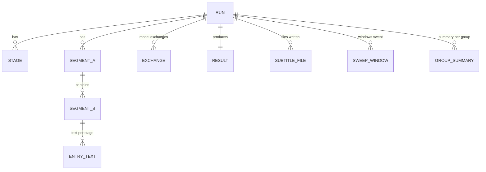

# 6 資料模型

狀態：已核可（2026-10-11）。本文回答：資料庫存什麼、實體如何關聯、保留多久。

## 選型

SQLite（`jdbc-pool` 的 `sqlite` 種類），理由同 [digest-rss ADR-024](../digest-rss/adr/ADR-024-sqlite-run-store.md)：單機、單寫入、免外部資料庫。

## 實體

| 實體 | 內容 |
|---|---|
| RUN | 資料庫指派的識別、轉錄實際使用的端點 `asr_endpoint` 與依據的模型 labels `asr_labels`（run 層級，每個 run 決定一次，[ADR-042](adr/ADR-042-asr-by-model-labels.md)；版本 6 之前的 run 與 labels 不明者為空）、降噪是否啟用 `denoise_enabled` 與降噪工具的自述 `denoise_tool`（名稱、版本與執行檔的 sha256；降噪階段完成後才記錄，未降噪、失敗或版本 9 之前的 run 為空；衰減上限在參數快照，[ADR-046](adr/ADR-046-denoise-before-vad.md)）、相對檔名（掃描模式在選定影片前為空字串，「無待處理」的 run 一直為空）、影片檔的大小與修改時間（檔案指紋，選定影片後即寫入；掃描以相對檔名加指紋判定「同一個檔案」的失敗次數，[ADR-040](adr/ADR-040-cron-scan-mode.md)）、開始與結束、結果狀態（含「無待處理」的說明名稱）、降級計數、參數快照（不含機密） |
| STAGE | 階段名稱、狀態、起訖時間、計數（輸入與輸出筆數、失敗、降級）、失敗原因 |
| SEGMENT_A / SEGMENT_B | 起訖秒、序號；B 指向所屬 A；B 另記是否由 A 原樣沿用、條目來源 `source`（`vad` 或 `sweep`，補掃的條目各成一個 A 組，組範圍即其窗口）與時間是否為估計值 `time_estimated`（補掃條目為是，[ADR-044](adr/ADR-044-asr-coverage-sweep.md)）。B 是字幕條目；補掃新增的條目與 VAD 條目依時間排序並連續編號 |
| ENTRY_TEXT | 每個 B 條目在各階段的文字：轉錄、潤飾、核對、翻譯；核對另記畫面時間點（秒，每張一筆）與一句畫面觀察，不存圖片 |
| EXCHANGE | 每次模型呼叫：階段、對象（A 組、B 條目、補掃窗口或整個 run；補掃窗口的階段為 `sweep`、對象序號為窗口序號）、模型 id（實際回報）、提示與回答文字、耗時、token 用量、結果（成功、重試、失敗、退回；失敗指終局失敗的最後一次嘗試，重試指之後還會再試的失敗嘗試）、`finish_reason`（回答的結束原因，如 `stop`、`length`；沒有回報者與版本 4 之前的呼叫為空）、`endpoint`（每一次模型呼叫實際的端點，所有階段都記錄，如 `audio.transcriptions`、`chat.completions`；版本 6 之前的呼叫為空）、`error`（服務以 4xx 拒絕時的 `<error.type>: <error.message>`；單次呼叫超過 `modelCallTimeoutSeconds` 時為 `TOTAL_TIMEOUT`；其他呼叫與版本 5 之前的呼叫為空，[ADR-043](../pipeline-engine/adr/ADR-043-upstream-error-detail.md)）。結果仍是封閉的四個值：回答因 token 上限被截斷（`finish_reason` 為 `length`）時，原因 `TRUNCATED` 記在 `finish_reason` 與 log，不是結果的值（[runbook](runbook.md) 第 10 節）；轉錄型模型的轉錄端點沒有 `finish_reason`，chat 路徑有 |
| SUBTITLE_FILE | `export` 階段寫出（或嘗試寫出）的字幕檔，以 RUN 與語系為鍵：語系（檔名中的語系）、收件根目錄下的相對路徑、是否寫出。記錄的是 run 實際做了什麼，Console 的 view 依此回答，不由檔案系統推測；版本 3 之前的 run 沒有 |
| SWEEP_WINDOW | 補掃送出的每個窗口一列，以 RUN 與窗口序號為鍵：起訖秒、辨識器說的語言（`language None` 為空）、文字、結果（`kept` 保留、`no_speech` 無語音、`filtered` 被當成幻覺過濾、`failed` 轉錄失敗而被略過）、失敗類型 `failure`（只有 `failed` 有值，如 `TRUNCATED`、`TOTAL_TIMEOUT`）。被過濾與失敗的窗口因此可查，不靜默消失；只存文字與時間。版本 8 之前的 run 沒有 |
| GROUP_SUMMARY | 摘要階段為每個有語音的 VAD-A 組記錄的最終摘要，以 RUN 與組序號為鍵：該組的起訖秒、摘要文字、是否缺少（降級或失敗的組記為缺少，文字為空值，不以空字串冒充成功）。分批摘要的中間彙整不記；只存文字與時間。版本 7 之前的 run 沒有 |
| RESULT | 來源語言標示、來源語言 SRT、繁體中文 SRT、影片摘要。影片旁的兩個字幕檔是這兩份 SRT 的副本（逐位元組相同，[ADR-039](adr/ADR-039-subtitle-files-beside-video.md)），不是新資料；「寫出了哪個檔」的紀錄是 SUBTITLE_FILE，不是 RESULT 的欄位 |

不存放：音訊、圖片、影片、影片探測以外的媒體資訊。EXCHANGE 的提示只含文字與圖片的時間點。

## 與 Engine run 的對應

pipeline 的執行環境不提供 Engine 的 run 識別，所以 RUN 不記它。管理員要從 Engine 的 run 找到對應紀錄時，以開始時間與相對檔名比對；掃描 run 的 Engine 參數 `file` 為空，改以開始時間比對（比對的作法見 [runbook](runbook.md) 第 9 節）。日後若 Engine 把 run 識別提供給 pipeline，再以只增不改的遷移加入欄位。

## 一致性與交易

- 每個階段結果以一個交易寫入；階段 STAGE 狀態在同一交易內更新。
- RUN 在開始時寫入，結束時更新；被中斷的 run 留下 `interrupted` 以外的最後階段狀態，由 Engine 的 run 狀態為準。

## 查詢模式

依 run 取得 SRT 與摘要；依 run 列出各階段計數與降級；依 run 與條目查看各階段文字差異。主鍵與外鍵索引即足夠。

## 保留

資料庫內容由 pipeline 在每個 run 開始時依參數 `retentionDays`（預設 90 天）清除過期的 run 及其下資料（含 SUBTITLE_FILE、SWEEP_WINDOW、GROUP_SUMMARY 的紀錄）。保留規則只作用於資料庫；字幕檔不在其範圍內。「無待處理」的 run 也留下 RUN 紀錄，受同一規則清除。

## 遷移

只增不改；版本記在資料庫；啟動時由 pipeline 建立或升級，作法沿用 digest-rss（WI-1405 定義）。檔案指紋以追加的遷移加入 RUN，舊的 run 兩欄為空。版本 3 加入表 SUBTITLE_FILE（WI-1422），舊的 run 沒有紀錄。版本 4 為 EXCHANGE 加入 `finish_reason` 欄（WI-1426），舊的呼叫為空。版本 5 為 EXCHANGE 加入 `error` 欄（WI-1428），舊的呼叫為空。版本 6 為 RUN 加入 `asr_endpoint`、`asr_labels`，為 EXCHANGE 加入 `endpoint`（WI-1429），舊的 run 與呼叫為空。版本 7 新增表 GROUP_SUMMARY（WI-1435），舊的 run 沒有紀錄。版本 8 為 SEGMENT_B 加入 `source`（預設 `vad`）與 `time_estimated`（預設 0），並新增表 SWEEP_WINDOW（WI-1436），所以舊的條目視為來源 VAD、時間不是估計值，舊的 run 沒有窗口。版本 9 為 RUN 加入 `denoise_enabled` 與 `denoise_tool`（WI-1440），舊的 run 為空，視為沒有降噪。版本 10 為 SWEEP_WINDOW 加入 `failure`（WI-1441），舊的窗口為空，視為沒有失敗。

## 多租戶

不適用：單一管理者的單機部署。
