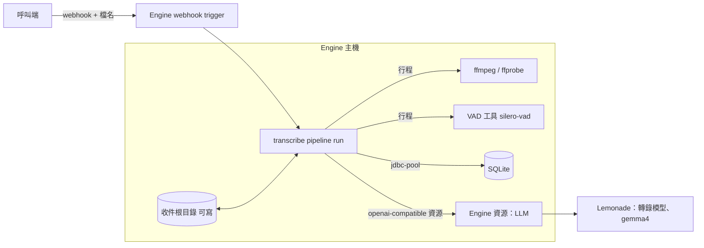
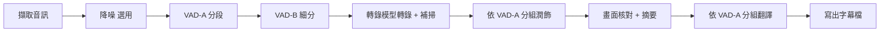

# transcribe pipeline（入口文件）

狀態：已核可（2026-10-11）。本頁回答：把影片轉成校對過的來源語言字幕、影片摘要與繁體中文字幕，要做什麼、關鍵決策是什麼、細節在哪裡。

## 目標與範圍

- 一個 runline pipeline：由 webhook 帶入檔名，或由 cron 觸發後自行掃描收件目錄挑出影片，將影片轉成單聲道 16 kHz WAV，以 silero-vad 分段，交給 Lemonade 的轉錄模型轉錄（依模型的 labels 走 `audio.transcriptions` 或 `chat.completions`，見下表「轉錄端點選擇」），再用 gemma4 做潤飾、畫面核對與摘要、翻譯為繁體中文。輸出一律是 SRT。
- 範圍外：影片上傳與收件目錄的填入（呼叫端負責）、媒體檔的保存（只存時間區間與文字）、中斷後續跑、說話者辨識、轉錄準確度的調校。
- 專案位置：獨立於 runline 儲存庫的外部專案 `runline-transcribe`（與 runline 同層，目前為空目錄），以 composite build 取得 devkit，作法同 [digest-rss](../digest-rss/README.md)。

## 關鍵決策結論

| 主題 | 結論 | 詳見 |
|---|---|---|
| webhook 帶檔名 | 修訂 ADR-005：webhook 可宣告「呼叫端提供的參數」，由請求本文傳入並依 pipeline 的參數宣告驗證；未宣告者行為不變 | [ADR-036](adr/ADR-036-webhook-caller-parameters.md) |
| 檔案位置 | 管理員以部署設定指定收件根目錄；檔名只能是其下的相對路徑 | [ADR-037](adr/ADR-037-unsafe-pipeline-and-intake-root.md) |
| 執行方式 | unsafe pipeline，直接呼叫主機上的 ffmpeg 與 VAD 工具；管理員逐版本允許 | [ADR-037](adr/ADR-037-unsafe-pipeline-and-intake-root.md) |
| 分段與字幕不變式 | VAD-A 上限 25 秒（過長處於最低能量點切開）；超過 6 秒者以更短靜音再切成 VAD-B；字幕條目來自 VAD-B 段或補掃窗口，轉錄後各階段不改變條目的數量與時間 | [ADR-038](adr/ADR-038-segment-model-and-stage-invariants.md) |
| VAD | 獨立 JVM 小工具（ONNX Runtime）只輸出語音機率，判定與切分在 pipeline；不需 Python，也不把原生程式庫放進 pipeline jar | [03-options.md](03-options.md) |
| LLM | 走 `openai-compatible` 資源（並行 1）；階段依模型分批，減少 Lemonade 切換模型 | [05-ipc.md](05-ipc.md) |
| 資料保存 | 全部進 SQLite；只存時間區間、文字、模型對話與階段紀錄，不存圖片與音訊 | [06-data-model.md](06-data-model.md) |
| 轉錄端點選擇 | 依 `asrModel` 在 `models.list` 的 `labels` 選擇：含 `transcription` 走 `audio.transcriptions`，否則走 `chat.completions` 帶音訊輸入（如 Qwen3-ASR）；找不到模型或沒有 `labels` 則設定錯誤 | [ADR-042](adr/ADR-042-asr-by-model-labels.md) |
| cron 掃描 | `file` 為空時 pipeline 掃描收件根目錄，每個 run 處理一部尚未產生 `_zh-TW.srt` 的影片；沒有待處理時 run 立即成功；同一檔案失敗達上限後不再被選中；仰賴 `llm` 資源容量為 1 | [ADR-040](adr/ADR-040-cron-scan-mode.md)、[runbook](runbook.md) 第 6.3 節 |
| 字幕檔輸出 | 最後階段 `export` 在影片旁寫出「影片檔名_語系.srt」兩個檔（來源語言與 `zh-TW`），內容與資料庫的 `result` 相同；收件根目錄須可寫 | [ADR-039](adr/ADR-039-subtitle-files-beside-video.md) |
| 補掃 | VAD 沒涵蓋的空隙（相鄰條目之間，含影片首尾）切成固定長度的窗口，逐窗口送同一個轉錄模型；有語音者成為新的字幕條目（標記來源為補掃、時間為估計值），疑似雜音的幻覺被過濾且可查；預設開啟 | [ADR-044](adr/ADR-044-asr-coverage-sweep.md) |
| 降噪後 VAD | VAD 之前以 DeepFilterNet3 降噪（獨立行程，預設開啟）；降噪音訊只供 VAD，切片與轉錄一律取自原始音訊；取代雙 VAD（ADR-045） | [ADR-046](adr/ADR-046-denoise-before-vad.md) |

## 元件關係

## 處理階段

補掃屬於轉錄階段，不是獨立階段。降噪開啟（預設）時多一個降噪階段，共 13 個階段；關閉時為 12 個，與沒有降噪功能時相同。

## 參數

本頁只列決定行為取捨的參數，其餘參數與完整清單見 [`runline-transcribe` 的 README](../../../../runline-transcribe/README.md)「參數」。所有值都是字串；不合法的值使 run 以 `CONFIGURATION` 失敗，訊息指出參數名稱。生成量上限與牆鐘上限的預設值是推導值，尚未在 arr 的 run 驗證。

| 參數 | 預設 | 意義 |
|---|---|---|
| `summaryMaxTokens` | `4096` | 摘要階段單次請求的生成上限（token，正整數），以 `max_tokens` 送出；超過即被截斷（`TRUNCATED`，沿用重試與降級）。thinking 開時推理與答案共用此額度 |
| `polishTokenMargin` | `1024` | 潤飾單次請求的生成上限的餘裕（非負整數）：上限 ＝ 該組送出的 SRT 字元數 ＋ 此值；超過即被截斷 |
| `translateTokenMargin` | `1024` | 翻譯單次請求的生成上限的餘裕（非負整數）：上限 ＝ 該組送出的 SRT 字元數 × 1.5（無條件捨去）＋ 此值；倍數是內部常數 |
| `modelCallTimeoutSeconds` | `180` | 單次模型呼叫（轉錄與各對話階段）的牆鐘時間上限，秒（大於 0 的數字）；超過即 `TOTAL_TIMEOUT`，視為可重試的失敗。只能縮短資源自己的逾時，不能放寬；與生成量上限互相獨立，任一先到即生效 |
| `sweepEnabled` | `true` | 是否補掃 VAD 沒涵蓋的空隙；`false` 時 run 的行為與沒有補掃時相同 |
| `sweepMinGapSeconds` | `3` | 相鄰條目之間（含影片首尾）的空隙超過這麼多秒才補掃（大於 0 的數字） |
| `sweepWindowSeconds` | `8` | 補掃把空隙切成連續等長窗口的長度，秒（大於 0 的數字，不得短於 `minPieceSeconds`）；最後一窗可較短 |
| `sweepMinChars` | `5` | 窗口回答的語言與整部影片的主要語言不同、且字母與數字少於這麼多個時，視為幻覺而丟棄（正整數） |
| `denoise` | `true` | VAD 之前是否降噪（`true`／`false`）；`false` 時沒有降噪階段、不呼叫降噪工具 |
| `denoiseAttenLimitDb` | `24` | 降噪的衰減上限，dB（0 至 100 的數字，含兩端）；0 為不降噪（原樣輸出），100 為不設上限 |

## 文件索引

| 章節 | 文件 | 狀態 |
|---|---|---|
| 1 需求摘要（含假設與待確認問題） | [01-requirements.md](01-requirements.md) | 已核可 |
| 2 現況觀察 | [02-current-state.md](02-current-state.md) | 已核可 |
| 3 方案比較 | [03-options.md](03-options.md) | 已核可 |
| 4 部署架構 | [04-deployment.md](04-deployment.md) | 已核可 |
| 5 IPC 模型 | [05-ipc.md](05-ipc.md) | 已核可 |
| 6 資料模型 | [06-data-model.md](06-data-model.md) | 已核可 |
| 7 非功能與風險 | [07-nfr-risks.md](07-nfr-risks.md) | 已核可 |
| 8 決策記錄（ADR-036 至 046；ADR-045 已被 ADR-046 取代） | [adr/](adr/) | 已核可 |
| 9 工作項 | [work-items/README.md](work-items/README.md) | 已核可 |
| 上線手冊 | [runbook.md](runbook.md)（管理員的上線、第一次執行、查詢、降級與中斷處置、排錯、已驗證與未驗證清單） | 已核可 |

## 與其他 stable 文件的關係

- [ADR-005](../pipeline-engine/adr/ADR-005-trigger-binding.md) 規定「Webhook 請求的內容不影響參數，只作為觸發訊號」，並註明需要由 webhook 內容決定參數時另開 ADR 修訂。ADR-036 即該修訂，取代 ADR-005 的這一條；README「Triggers」與 `08-api.md` 的 webhook 段落已由 [WI-1400](work-items/WI-1400-webhook-caller-parameters.md) 同步修訂。
- 編號：ADR-034、035 與 WI-1300 至 1305 屬於 [pipeline-views](../pipeline-views/README.md)；本專案使用 ADR-036 至 038 與 WI-1400 起。
