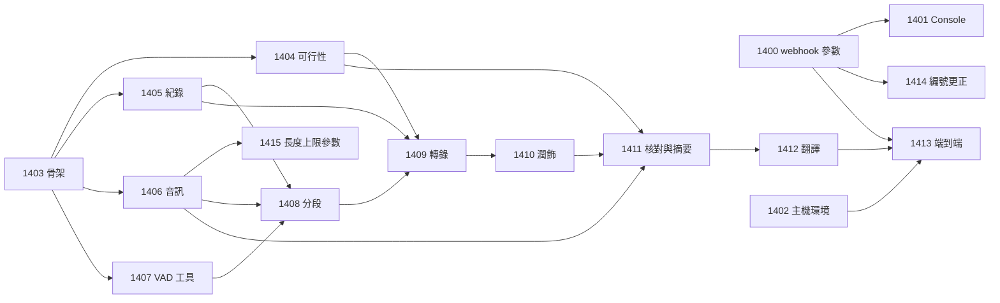

# transcribe pipeline 工作項總覽

狀態：已核可（2026-10-11）。本文回答：要交給 tdd-coder 的工作有哪些、先後順序為何。tdd-coder 只需讀本頁加被派到的那一項，以及入口 [README](../README.md)。編號從 1400 起，與其他專案分開（pipeline-views 使用 WI-1300 至 1305）。一次派一項。

儲存庫分工：標「R」者改動 runline 儲存庫；標「T」者在外部專案 `runline-transcribe`（與 runline 同層；WI-1403 負責建立）。派工時須在回報要求中指明儲存庫。

| 項目 | 儲存庫 | 目標 | 相依 | 狀態 |
|---|---|---|---|---|
| [WI-1400](WI-1400-webhook-caller-parameters.md) | R | webhook 的呼叫端提供參數（ADR-036）：Engine、API、文件 | 無 | 已完成（2026-10-12） |
| [WI-1401](WI-1401-console-caller-parameters.md) | R | Console 的 trigger 表單支援呼叫端提供參數 | WI-1400 | 已完成（2026-10-12；單元、契約、e2e、安全腳本通過） |
| [WI-1402](WI-1402-host-runtime-deployment.md) | R | 選配覆蓋層：Engine 主機提供 ffmpeg、VAD 工具執行環境與收件目錄掛載 | 無 | 已完成（2026-10-12；systemd 主機未驗證） |
| [WI-1403](WI-1403-pipeline-skeleton.md) | T | 專案骨架、參數宣告、資源角色、收件路徑檢查、階段 log、取消 | 無 | 已完成（2026-10-12） |
| [WI-1404](WI-1404-capability-feasibility.md) | T | 可行性關卡：對真實 Lemonade 驗證音訊轉錄與圖片輸入 | WI-1403 | 量測工具已完成；對真實 Lemonade 的四項量測**未驗證**，待使用者執行（步驟見 runline-transcribe 的 docs/feasibility-report.md） |
| [WI-1405](WI-1405-run-store.md) | T | SQLite 紀錄：結構、版本、run 與階段、保留清除 | WI-1403 | 已完成（2026-10-12） |
| [WI-1406](WI-1406-audio-extraction.md) | T | ffprobe 檢查與擷取單聲道 16 kHz WAV；畫面擷取能力 | WI-1403 | 已完成（2026-10-12） |
| [WI-1407](WI-1407-vad-tool.md) | T | VAD 命令列工具（語音機率）與其契約 | WI-1403 | 已完成（2026-10-12；與官方 Python 基準最大差 5e-8） |
| [WI-1408](WI-1408-vad-a-b-segmentation.md) | T | VAD-A／VAD-B 分段與最低能量切開 | WI-1405、WI-1406、WI-1407 | 已完成（2026-10-12；與官方區間 0 取樣誤差） |
| [WI-1409](WI-1409-transcription.md) | T | qwen-asr 轉錄 | WI-1404、WI-1405、WI-1408 | 已完成（2026-10-12；對真實 Lemonade 未驗證） |
| [WI-1410](WI-1410-polish.md) | T | 依 VAD-A 分組潤飾 | WI-1409 | 已完成（2026-10-12；對真實 Lemonade 未驗證） |
| [WI-1411](WI-1411-visual-check-and-summary.md) | T | 畫面核對與影片摘要 | WI-1404、WI-1406、WI-1410 | 已完成（2026-10-12；對真實 Lemonade 未驗證） |
| [WI-1412](WI-1412-translation.md) | T | 繁體中文翻譯與 SRT 結果 | WI-1411 | 已完成（2026-10-12；對真實 Lemonade 未驗證） |
| [WI-1413](WI-1413-end-to-end-and-runbook.md) | T | 端到端驗證與管理員上線手冊 | WI-1400、WI-1402、WI-1412、WI-1416 | 已完成（2026-10-12；手冊為 [runbook.md](../runbook.md)；對真實 Lemonade 的驗證清單在手冊第 17 節，待使用者執行） |
| [WI-1414](WI-1414-numbering-correction.md) | R | 編號更正：把 WI-1400 實作中的 ADR-034／WI-1300 引用改為 ADR-036／WI-1400 | WI-1400 驗收通過 | 已完成（2026-10-12） |
| [WI-1415](WI-1415-max-media-seconds-parameter.md) | T | 影片長度上限參數 `maxMediaSeconds`（預設 21600） | WI-1406 | 已完成（2026-10-12） |
| [WI-1416](WI-1416-combined-runtime-image.md) | R | 轉錄與瀏覽器共用的 Engine 映像（兩個覆蓋層可同時使用） | WI-1402 | 已完成（2026-10-12；systemd 主機與 GPU 疊加檔未驗證） |
| [WI-1417](WI-1417-end-to-end-defect-fixes.md) | T | 端到端驗證發現的缺陷修正（最後一格畫面、工作目錄設定、設定類錯誤快速失敗、暫存目錄、失敗原因） | WI-1413 | 已完成（2026-10-12；以 devkit 驗證，未在打包 Engine 與真實 Lemonade 重跑） |
| [WI-1418](WI-1418-webhook-nul-parameter.md) | R | 呼叫端參數含 NUL 字元回 400；釐清 jdbc-statement 執行緒警告 | WI-1400 | 已完成（2026-10-12） |
| [WI-1419](WI-1419-deploy-alignment.md) | R | 部署檔與 pipeline 實作對齊（檢查腳本的工作目錄、VAD 暫存、模型清單端點說明） | WI-1417、WI-1402 | 已完成（2026-10-12；真實映像與 systemd 下未實跑） |
| [WI-1420](WI-1420-subtitle-export.md) | T | 新增 `export` 階段：把來源語言與繁體中文字幕寫到影片旁，檔名為「影片檔名_語系.srt」（[ADR-039](../adr/ADR-039-subtitle-files-beside-video.md)） | WI-1412、WI-1417 | 已完成（2026-10-12；devkit 驗證，打包 Engine 的實機驗證在 WI-1424） |
| [WI-1421](WI-1421-writable-intake-root.md) | R | 收件根目錄改為可寫；部署檔與文件對齊 | WI-1420 | 已完成（2026-10-12；Docker 實機驗證，systemd 主機與真實 Lemonade 未驗證） |
| [WI-1422](WI-1422-transcribe-views.md) | T | transcribe 在 Console 的資料區：run 清單、階段、降級、逐條文字、結果與寫出的字幕檔（pipeline view） | WI-1420 | 已完成（2026-10-12；打包 Engine 讀取五個 view 通過，Console 畫面與 V2 資料庫經 Engine 升級未驗證） |
| [WI-1425](WI-1425-runbook-views.md) | R | runbook 與資料模型補上 Console 的 view 與 `subtitle_file` 表（結構版本 3） | WI-1422 | 已完成（2026-10-12） |
| [WI-1423](WI-1423-cron-scan.md) | T | cron 掃描模式：`file` 為空時挑一部尚未產生字幕的影片處理（[ADR-040](../adr/ADR-040-cron-scan-mode.md)） | WI-1420 | 已完成（2026-10-12；第 10 條重疊 run 的實機驗證在 WI-1424） |
| [WI-1424](WI-1424-cron-scan-docs.md) | R | cron 掃描的文件、trigger 設定與實機驗證 | WI-1423、WI-1421 | 已完成（2026-10-12；打包的 Engine 與真實 cron trigger 驗證篩選、失敗上限與重疊 run，模型服務為 FakeOpenAiServer，真實 Lemonade 未驗證） |

派工順序：WI-1420 → WI-1421 → WI-1423 → WI-1424 → WI-1422，一次派一項。WI-1422 放最後，使 `runs` view 涵蓋「無待處理」的 run 與檔案指紋。

共同約束（所有 T 項）：遵守 [ADR-037](../adr/ADR-037-unsafe-pipeline-and-intake-root.md)、[ADR-038](../adr/ADR-038-segment-model-and-stage-invariants.md)；pipeline 只用 JDK、core、Kotlin 標準函式庫；外部系統（Lemonade、SQLite、ffmpeg、VAD 工具）在測試中使用真實實作或自製的簡易真實實作，不使用 stub 或 mock；不存放音訊與圖片；機密不進 log。
