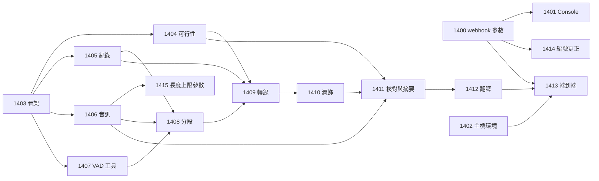

# transcribe pipeline 工作項總覽

狀態：已核可（2026-10-11）。本文回答：要交給 tdd-coder 的工作有哪些、先後順序為何。tdd-coder 只需讀本頁加被派到的那一項，以及入口 [README](../README.md)。編號從 1400 起，與其他專案分開（pipeline-views 使用 WI-1300 至 1305）。一次派一項。

儲存庫分工：標「R」者改動 runline 儲存庫；標「T」者在外部專案 `runline-transcribe`（與 runline 同層；WI-1403 負責建立）。派工時須在回報要求中指明儲存庫。

| 項目 | 儲存庫 | 目標 | 相依 | 狀態 |
|---|---|---|---|---|
| [WI-1400](WI-1400-webhook-caller-parameters.md) | R | webhook 的呼叫端提供參數（ADR-036）：Engine、API、文件 | 無 | 已完成（2026-10-12） |
| [WI-1401](WI-1401-console-caller-parameters.md) | R | Console 的 trigger 表單支援呼叫端提供參數 | WI-1400 | 已完成（2026-10-12；單元、契約、e2e、安全腳本通過） |
| [WI-1402](WI-1402-host-runtime-deployment.md) | R | 選配覆蓋層：Engine 主機提供 ffmpeg、VAD 工具執行環境與收件目錄掛載 | 無 | 已完成（2026-10-12；systemd 主機未驗證） |
| [WI-1403](WI-1403-pipeline-skeleton.md) | T | 專案骨架、參數宣告、資源角色、收件路徑檢查、階段 log、取消 | 無 | 已完成（2026-10-12） |
| [WI-1404](WI-1404-capability-feasibility.md) | T | 可行性關卡：對真實 Lemonade 驗證音訊轉錄與圖片輸入 | WI-1403 | 量測工具已完成；對真實 Lemonade 的四項量測**未驗證**，待使用者執行（步驟見 runline-transcribe 的 docs/feasibility-report.md） |
| [WI-1405](WI-1405-run-store.md) | T | SQLite 紀錄：結構、版本、run 與階段、保留清除 | WI-1403 | 已完成（2026-10-12） |
| [WI-1406](WI-1406-audio-extraction.md) | T | ffprobe 檢查與擷取單聲道 16 kHz WAV；畫面擷取能力 | WI-1403 | 已完成（2026-10-12） |
| [WI-1407](WI-1407-vad-tool.md) | T | VAD 命令列工具（語音機率）與其契約 | WI-1403 | 已完成（2026-10-12；與官方 Python 基準最大差 5e-8） |
| [WI-1408](WI-1408-vad-a-b-segmentation.md) | T | VAD-A／VAD-B 分段與最低能量切開 | WI-1405、WI-1406、WI-1407 | 已完成（2026-10-12；與官方區間 0 取樣誤差） |
| [WI-1409](WI-1409-transcription.md) | T | 轉錄模型轉錄（端點依 labels 選擇，[ADR-042](../adr/ADR-042-asr-by-model-labels.md)） | WI-1404、WI-1405、WI-1408 | 已完成（2026-10-12；對真實 Lemonade 未驗證） |
| [WI-1410](WI-1410-polish.md) | T | 依 VAD-A 分組潤飾 | WI-1409 | 已完成（2026-10-12；對真實 Lemonade 未驗證） |
| [WI-1411](WI-1411-visual-check-and-summary.md) | T | 畫面核對與影片摘要 | WI-1404、WI-1406、WI-1410 | 已完成（2026-10-12；對真實 Lemonade 未驗證） |
| [WI-1412](WI-1412-translation.md) | T | 繁體中文翻譯與 SRT 結果 | WI-1411 | 已完成（2026-10-12；對真實 Lemonade 未驗證） |
| [WI-1413](WI-1413-end-to-end-and-runbook.md) | T | 端到端驗證與管理員上線手冊 | WI-1400、WI-1402、WI-1412、WI-1416 | 已完成（2026-10-12；手冊為 [runbook.md](../runbook.md)；對真實 Lemonade 的驗證清單在手冊第 17 節，待使用者執行） |
| [WI-1414](WI-1414-numbering-correction.md) | R | 編號更正：把 WI-1400 實作中的 ADR-034／WI-1300 引用改為 ADR-036／WI-1400 | WI-1400 驗收通過 | 已完成（2026-10-12） |
| [WI-1415](WI-1415-max-media-seconds-parameter.md) | T | 影片長度上限參數 `maxMediaSeconds`（預設 21600） | WI-1406 | 已完成（2026-10-12） |
| [WI-1416](WI-1416-combined-runtime-image.md) | R | 轉錄與瀏覽器共用的 Engine 映像（兩個覆蓋層可同時使用） | WI-1402 | 已完成（2026-10-12；systemd 主機與 GPU 疊加檔未驗證） |
| [WI-1417](WI-1417-end-to-end-defect-fixes.md) | T | 端到端驗證發現的缺陷修正（最後一格畫面、工作目錄設定、設定類錯誤快速失敗、暫存目錄、失敗原因） | WI-1413 | 已完成（2026-10-12；以 devkit 驗證，未在打包 Engine 與真實 Lemonade 重跑） |
| [WI-1418](WI-1418-webhook-nul-parameter.md) | R | 呼叫端參數含 NUL 字元回 400；釐清 jdbc-statement 執行緒警告 | WI-1400 | 已完成（2026-10-12） |
| [WI-1419](WI-1419-deploy-alignment.md) | R | 部署檔與 pipeline 實作對齊（檢查腳本的工作目錄、VAD 暫存、模型清單端點說明） | WI-1417、WI-1402 | 已完成（2026-10-12；真實映像與 systemd 下未實跑） |
| [WI-1420](WI-1420-subtitle-export.md) | T | 新增 `export` 階段：把來源語言與繁體中文字幕寫到影片旁，檔名為「影片檔名_語系.srt」（[ADR-039](../adr/ADR-039-subtitle-files-beside-video.md)） | WI-1412、WI-1417 | 已完成（2026-10-12；devkit 驗證，打包 Engine 的實機驗證在 WI-1424） |
| [WI-1421](WI-1421-writable-intake-root.md) | R | 收件根目錄改為可寫；部署檔與文件對齊 | WI-1420 | 已完成（2026-10-12；Docker 實機驗證，systemd 主機與真實 Lemonade 未驗證） |
| [WI-1422](WI-1422-transcribe-views.md) | T | transcribe 在 Console 的資料區：run 清單、階段、降級、逐條文字、結果與寫出的字幕檔（pipeline view） | WI-1420 | 已完成（2026-10-12；打包 Engine 讀取五個 view 通過，Console 畫面與 V2 資料庫經 Engine 升級未驗證） |
| [WI-1425](WI-1425-runbook-views.md) | R | runbook 與資料模型補上 Console 的 view 與 `subtitle_file` 表（結構版本 3） | WI-1422 | 已完成（2026-10-12） |
| [WI-1423](WI-1423-cron-scan.md) | T | cron 掃描模式：`file` 為空時挑一部尚未產生字幕的影片處理（[ADR-040](../adr/ADR-040-cron-scan-mode.md)） | WI-1420 | 已完成（2026-10-12；第 10 條重疊 run 的實機驗證在 WI-1424） |
| [WI-1424](WI-1424-cron-scan-docs.md) | R | cron 掃描的文件、trigger 設定與實機驗證 | WI-1423、WI-1421 | 已完成（2026-10-12；打包的 Engine 與真實 cron trigger 驗證篩選、失敗上限與重疊 run，模型服務為 FakeOpenAiServer，真實 Lemonade 未驗證） |

| [WI-1426](WI-1426-finish-reason-length.md) | T | 模型因 token 上限被截斷（`finish_reason=length`）時，明確辨識、記錄並以專用原因重試與降級 | 無 | 已完成（2026-10-12；結構版本 4；runbook 與資料模型見 WI-1427） |

| [WI-1427](WI-1427-runbook-truncated.md) | R | runbook 與資料模型補上 `TRUNCATED`、`truncated=N` 與 `exchange.finish_reason`（結構版本 4） | WI-1426 | 已完成（2026-10-12；真實 Lemonade 的 `length` 情境未驗證） |

| [WI-1428](WI-1428-upstream-error-message.md) | T | 模型服務以 4xx 拒絕請求時，失敗訊息帶出對方的錯誤說明，明確的「不支援」不重試 | WI-1430（[pipeline-engine](../../pipeline-engine/work-items/WI-1430-upstream-error-detail-channel.md)） | 已完成（2026-10-13；結構版本 5，新欄位 `exchange.error`；修正三個寫死版本號的舊測試後未重跑全套；對真實 Lemonade 與打包 Engine 未驗證；文件見 WI-1431） |
| [WI-1429](WI-1429-asr-endpoint-by-labels.md) | T | 轉錄依 `asrModel` 的 `labels` 選擇 `audio.transcriptions` 或 `chat.completions`（[ADR-042](../adr/ADR-042-asr-by-model-labels.md)） | WI-1428 | 已完成（2026-10-13；結構版本 6，新欄位 `run.asr_endpoint`、`run.asr_labels`、`exchange.endpoint`；全套 853 個測試通過，Lemonade 契約測試略過；對真實 Lemonade 與打包 Engine 未驗證；文件見 WI-1431） |

| [WI-1431](WI-1431-docs-asr-endpoint.md) | R | runbook、入口文件與資料模型對齊 ASR 端點選擇、錯誤說明、結構版本 5、6 與分析器判定清單 | WI-1429 | 已完成（2026-10-13；31 項分析器清單以 jar 常數核對，未對 arr 上傳結果核對） |

| [WI-1432](WI-1432-arr-run-findings.md) | T | 每次模型呼叫都記錄端點（含潤飾）；摘要等短答階段有生成量與單次時間上限 | WI-1429、WI-1431 | 已完成（2026-10-13；全套 868 個測試通過，16 個略過；新參數 `summaryMaxTokens`、`modelCallTimeoutSeconds`；真實 Lemonade 是否遵守 `max_tokens` 未驗證） |

| [WI-1433](WI-1433-console-summary-and-frames.md) | T | Console 新增 `summary`（摘要分段）與 `frames`（畫面時間點、觀察）view | WI-1422、WI-1432 | 已完成（2026-10-13；`runs` 的影片檔欄改為鑽取到 `summary`，`run` 欄鑽取到 `run-stages`；各 VAD-A 組的摘要由 WI-1435 記錄；在既有 engine.jar 上驗證，未用新建的 Engine；完整重跑兩次皆為 841 個測試、16 個略過（皆為需真實 Lemonade 的契約測試）、0 失敗；WI-1432 當時回報的 868 無法重現，原因不明） |

| [WI-1435](WI-1435-group-summaries.md) | T | 記錄各 VAD-A 組的摘要（結構版本 7）並在 `summary` view 顯示 | WI-1433、WI-1432 | 已完成（2026-10-13；結構版本 7，新表 `group_summary`；`summary` view 的排序改為（範圍、段序），缺少的組顯示為一列空文字；主模組 858 個測試（比 WI-1433 的 841 多 17 個）加 vad 模組，共 894 個、16 個略過、0 失敗，由架構師唯讀加總結果檔；未上傳到真實 Engine 讀 view） |

| [WI-1434](WI-1434-polish-generation-limit.md) | T | 潤飾請求依輸入規模加生成量上限，超過走 `TRUNCATED` 處理 | WI-1432 | 已完成（2026-10-13；新參數 `polishTokenMargin`，預設 1024，上限＝該組送出的 SRT 字元數加餘裕；規則與預設值為推導值，未在 arr 驗證；主模組 864＋vad 36＝900 個測試、16 個略過、0 失敗，由架構師加總結果檔） |

| [WI-1437](WI-1437-translate-generation-limit.md) | T | 翻譯請求依輸入規模加生成量上限，超過走 `TRUNCATED` 處理 | WI-1434 | 已完成（2026-10-13；新參數 `translateTokenMargin`，預設 1024，上限＝該組 SRT 字元數 × 1.5 加餘裕，倍數為內部常數；規則與預設值為推導值，未在 arr 驗證；主模組 869＋vad 36＝905 個測試、16 個略過、0 失敗，由架構師加總結果檔） |

| [WI-1436](WI-1436-asr-coverage-sweep.md) | T | 以 ASR 補掃 VAD 空隙（[ADR-044](../adr/ADR-044-asr-coverage-sweep.md)） | WI-1429、WI-1432、WI-1435 | 已完成（2026-10-13；新參數 `sweepEnabled`、`sweepMinGapSeconds`=3、`sweepWindowSeconds`=8、`sweepMinChars`=5，預設值為推導值，未在 arr 驗證；結構版本 8；主模組 938＋vad 36＝974 個測試、16 個略過、0 失敗，由架構師加總結果檔；窗口轉錄失敗改為降級見 WI-1441） |

| [WI-1438](WI-1438-ten-vad-tool.md) | T | TEN VAD 命令列工具（Java＋ONNX，退路為官方原生函式庫）與可行性關卡（[ADR-045](../adr/ADR-045-dual-vad.md)） | WI-1407 | 已取代，不派工（[ADR-046](../adr/ADR-046-denoise-before-vad.md)、[WI-1440](WI-1440-denoise-before-vad.md)；保留供日後參考） |

| [WI-1439](WI-1439-dual-vad-combination.md) | T | 兩個 VAD 機率以 0.1 秒格子加權（0.3／0.7）合併並分段 | WI-1438、WI-1434、WI-1435 | 已取代，不派工（同 WI-1438） |
| [WI-1440](WI-1440-denoise-before-vad.md) | T | VAD 前以 DeepFilterNet3 降噪（[ADR-046](../adr/ADR-046-denoise-before-vad.md)） | WI-1434、WI-1435 | 已完成（2026-10-13；結構版本 9；新參數 `denoise`、`denoiseAttenLimitDb`；驗收 7 以 `~/fixtures/dfn/` 的固定資料驗證：37 段、涵蓋 20.46%、邊界差 0.0 秒；測試需設環境變數 `TRANSCRIBE_DFN_FIXTURES`，未設則該 4 個測試失敗；主模組 979＋vad 36＝1015 個測試、16 個略過、0 失敗，由架構師加總結果檔；Linux 容器內的 wrapper、雜湊檢查與 arr run 未驗證） |
| [WI-1441](WI-1441-sweep-window-failure-degrades.md) | T | 補掃窗口轉錄失敗時降級（略過、計數、可查），不讓 run 失敗 | WI-1436 | 已完成（2026-10-13；結構版本 10，`sweep_window` 新增 `failure` 欄；新計數 `sweepFailed`；主模組 993＋vad 36＝1029 個測試、16 個略過、0 失敗，由架構師加總結果檔；失敗窗口計入降級見 WI-1443） |
| [WI-1443](WI-1443-failed-sweep-window-is-degraded.md) | T | 補掃窗口失敗計入降級（outcome 為 `success-degraded`） | WI-1441 | 已完成（2026-10-13；一行程式：失敗窗口計入 `run.degraded`，outcome 為 `success-degraded`；無結構變更；完整測試主模組 999＋vad 36＝1035 個、16 個略過、0 失敗，由架構師加總結果檔，涵蓋 WI-1444 對 T 的改動；RUN SUMMARY 括號內不列轉錄階段，失敗窗口數看 `sweepFailed`） |
| [WI-1444](WI-1444-denoise-tool-delivery.md) | R | 降噪 wrapper 與固定版本的 deep-filter 隨映像交付，部署前檢查涵蓋 | WI-1440 | 已完成，真實 Engine 驗證待部署新 tag 後（2026-10-13；wrapper 單一來源在 R 的 `deploy/bin`，T 的測試取用它，T 降噪測試 36 個通過；映像與檢查腳本已完成，未提交；在 Engine 基底映像（amd64）內驗證 wrapper 與 `runline-transcribe-check`，未跑真實 Engine run；新映像需新 tag，v0.0.9 不含工具） |
| [WI-1445](WI-1445-prompt-parameters.md) | T | 各階段送給模型的 system prompt 做成參數，預設為現行 prompt（ASR 預設為空） | WI-1429、WI-1436 | 已完成（2026-10-13；六個參數 `asrSystemPrompt`（預設空）、`polishSystemPrompt`、`verifySystemPrompt`、`summaryGroupSystemPrompt`、`summaryVideoSystemPrompt`、`translateSystemPrompt`，長度上限 8000 字元，預設值為現行 prompt 的單一常數；無結構變更；相關 292 個測試通過，未跑完整測試；真實 Lemonade 未驗證） |
| [WI-1446](WI-1446-console-long-text-defaults.md) | R | Console 建立 run 與 trigger 頁面完整顯示與編輯長文字參數的預設值 | 無 | 已完成（2026-10-13；含換行或超過 80 字元的預設值以多行文字區輸入、以可捲動的區塊顯示全文並提供「以預設值填入」，建立 run 與 trigger 表單共用元件 `ParameterValue`；Console 單元與元件測試 1380 個通過、型別檢查 0 錯誤，由實作者回報；e2e 與瀏覽器實際外觀未驗證） |
| [WI-1447](WI-1447-docs-alignment-wi1443-1446.md) | R、T | 文件對齊：prompt 參數、Console 長文字預設值、失敗窗口降級與先前遺留落差寫進入口、runbook、資料模型、IPC | WI-1443、WI-1444、WI-1445、WI-1446 | 已完成（2026-10-13；入口參數表、runbook 6.4 節、資料模型、IPC、容量式與 T README 已對齊，參數共 51 個；文件測試 41 個通過；未 commit；其餘參數的預設值未逐項對照程式） |
| [WI-1448](WI-1448-batches-with-read-only-context.md) | T | 潤飾與翻譯以批次送出，附唯讀的前後文；翻譯前文附譯文、不附摘要；重試用盡時對半拆開（ADR-049） | 無 | 已完成（2026-10-13；三個參數 `contextBatchEntries`（20）、`contextSeconds`（120）、`contextMaxEntries`（30），潤飾改用共用的 `ChatCalls`，請求過大時與翻譯一樣拆開或降級；`exchange.target` 新增 `batch`，降級檢視顯示「批次」；STAGE 的計數改以條目計；完整測試 1053 個，失敗只有 4 個需要 `TRANSCRIBE_DFN_FIXTURES` 的 `DenoiseFixtureTest`（本機未設定）；真實 Lemonade 未驗證；未 commit） |
| [WI-1449](WI-1449-merge-short-subtitles.md) | T | 輸出 SRT 時把太短且相鄰的條目合併顯示（ADR-050） | 無 | 已完成（2026-10-14；三個參數 `subtitleMergeGapSeconds`（1.0）、`subtitleShortSeconds`（1.5）、`subtitleMaxSeconds`（6），合併在 `SubtitleSrt` 內依毫秒時間決定，核對與翻譯寫的兩份 SRT 與字幕檔一致，`translate` 的 RESULT 記 `merged=<n>`；資料庫條目不變；完整測試 1070 個，失敗只有 4 個需要 `TRANSCRIBE_DFN_FIXTURES` 的 `DenoiseFixtureTest`；未 commit） |
| [WI-1450](WI-1450-segmentation-defaults-for-six-seconds.md) | T | 在 arr 比較分段參數，依約 6 秒的原則決定預設值（ADR-050） | WI-1448、WI-1449 | 已核可（2026-10-13），待派工 |
| [WI-1442](WI-1442-docs-alignment-wi1432-1440.md) | R、T | 文件對齊：WI-1432 至 WI-1441 的行為寫進入口、runbook、資料模型、IPC、部署與相關 ADR | WI-1440、WI-1441 | 已完成（2026-10-13；文件與 T 儲存庫 README 已對齊至結構版本 10；T 的 `*DocumentationTest` 9 個類別重跑全過；失敗窗口計入降級見 WI-1443，降噪工具的映像交付見 WI-1444，prompt 參數與 Console 見 WI-1447） |

派工順序：WI-1420 → WI-1421 → WI-1423 → WI-1424 → WI-1422，一次派一項。WI-1422 放最後，使 `runs` view 涵蓋「無待處理」的 run 與檔案指紋。

共同約束（所有 T 項）：遵守 [ADR-037](../adr/ADR-037-unsafe-pipeline-and-intake-root.md)、[ADR-038](../adr/ADR-038-segment-model-and-stage-invariants.md)；pipeline 只用 JDK、core、Kotlin 標準函式庫；外部系統（Lemonade、SQLite、ffmpeg、VAD 工具）在測試中使用真實實作或自製的簡易真實實作，不使用 stub 或 mock；不存放音訊與圖片；機密不進 log。
