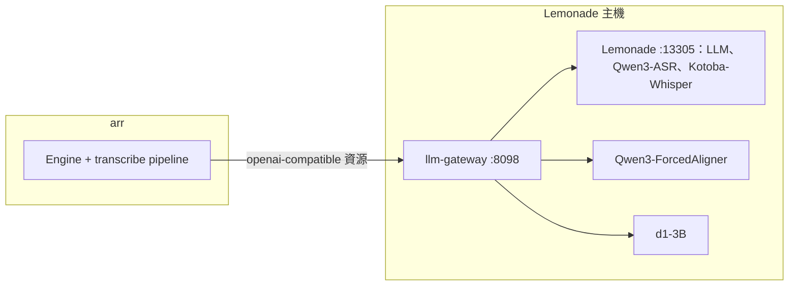

# 4 部署

狀態：已核可（2026-10-16）。本文回答：為了對齊、二次轉錄與場景偵測，各主機與服務要多提供什麼。現行部署見 [stable transcribe-pipeline 04](../../stable/transcribe-pipeline/04-deployment.md) 與 `deploy/transcribe.md`；本文只寫差異。對齊的位置見 [ADR-056](adr/ADR-056-alignment-on-gateway-gpu.md)。

## 拓撲

- 同一張 GPU 上，Lemonade、對齊模型與 d1 三方輪流佔用，由 gateway 切換。
- Engine 的所有模型呼叫都經 gateway。

## 對齊（llm-gateway）

- **形態**：gateway 程序內載入的模型，以 OpenAI 相容的音訊轉錄端點提供，契約見 [05](05-ipc.md)。
- **執行環境**：沿用 gateway 的 Python 環境與 CUDA；新增對齊所需的程式庫，版本固定。
- **模型檔**：Qwen3-ForcedAligner 固定 revision 與檔案雜湊，預先下載到主機；執行時不連網下載。
- **維運**：
  - 由使用者在 Lemonade 主機維運（user 層級 systemd 服務 `llm-gateway`），不隨 runline 映像部署；
  - gateway 的健康狀態列出目前佔用 GPU 的一方，以及對齊模型是否已載入。
- **Engine 映像**：不變，不加入 Python 與對齊模型。

## 第二個轉錄模型（Lemonade）

- **形態**：Lemonade 的自訂模型，名稱 `user.Kotoba-Whisper-v2.0`（顯示為 `Kotoba-Whisper-v2.0`），recipe 為 whispercpp，權重為 `kotoba-tech/kotoba-whisper-v2.0-ggml` 的 `ggml-kotoba-whisper-v2.0.bin`（約 1.5 GB），標籤含 transcription；經 gateway 以 `audio.transcriptions` 端點提供。
- **維運**：由使用者或 homelab-deployer 在 Lemonade 主機註冊與保留；Engine 映像與 runline 不負責下載。
- **載入**：與 llm 槽分開；冷載入加一次推理約 6 秒。
- **Engine 資源**：音訊轉錄條目已啟用；資源的放行模型清單（`allowedModels`，若有設定）須包含此模型，否則二次轉錄以設定類失敗略過。
- **缺少時**：主機未註冊此模型，二次轉錄在第一次呼叫失敗後於該 run 內停用，run 其餘行為不變（[ADR-075](adr/ADR-075-second-pass-default-on-with-kotoba.md)）。
- **日語專用**：非日語的影片預設不做二次轉錄；要使用時改模型參數為多語模型（例如 Whisper-Large-v3-Turbo）並把語言加入執行清單。

## Engine 資源

- transcribe 使用的 `openai-compatible` 資源，上游位址從 Lemonade（13305）改為 gateway（8098）。
- 音訊轉錄條目維持啟用，請求大小上限須容納 30 秒的音訊。
- 這項切換由使用者或 homelab-deployer 在 WI-1455 的版本上線前完成。
- 切換後，同一資源的其他 pipeline（例如 digest-rss）也改經 gateway；gateway 對 d1 與對齊以外的請求原樣轉發。

## 場景偵測

使用既有的 ffmpeg，不新增工具。

## 畫面擷取

沿用現行能力（ffmpeg 每秒一張、縮到 `frameMaxEdgePixels`、只在記憶體），改以場景片段為單位擷取。

## 組態

| 項目 | 位置 | 用途 |
|---|---|---|
| 對齊模型名稱 | transcribe 的 pipeline 參數 | 送到音訊轉錄條目的模型名稱，須與 gateway 的設定一致 |
| 第二個轉錄模型、執行二次轉錄的語言、run 語言、書寫系統占比門檻、幻覺句清單 | transcribe 的 pipeline 參數 | 二次轉錄的行為；模型留空即關閉 |
| 對齊模型的 revision、裝置、切換逾時 | gateway 的環境變數 | 比照 d1 的設定方式 |
| Engine 資源的上游位址 | Engine 的資源設定 | 指向 gateway |
| 其他 pipeline 參數 | 見 [05](05-ipc.md) 與各 ADR；完整清單在 runline-transcribe 的 README | |

## 檢查

- gateway 無法載入對齊模型或取得 GPU 時，回覆服務不可用；pipeline 依重試、降級與止損處理（[ADR-055](adr/ADR-055-thinking-policy-and-early-stop.md)）。
- 部署後，以一段短音訊經 Engine 資源呼叫對齊模型，確認可用（由 WI-1462 提供步驟）。
- 部署後，以一段短日語音訊經 Engine 資源呼叫第二個轉錄模型，確認可用。
