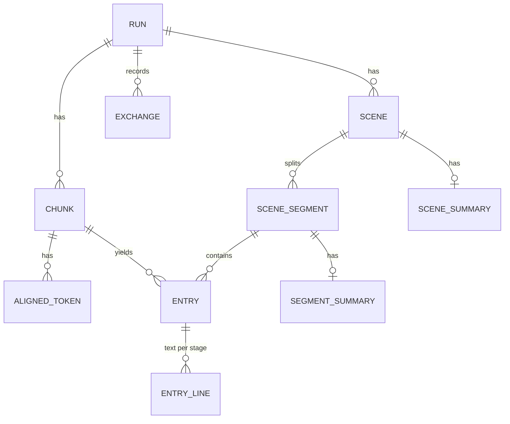

# 6 資料模型

狀態：已核可（2026-10-18）。本文回答：新流程要記錄哪些資料、與現行結構如何並存。資料庫仍是 pipeline 自己的 SQLite（`transcribe.db`），選型與保留原則不變，見 [stable 06](../../stable/transcribe-pipeline/06-data-model.md)。

## 新增實體

| 實體 | 內容 |
|---|---|
| CHUNK | 長片段：RUN 內序號、起訖秒、是否有語音（沒有則不送轉錄）、轉錄回報的語言、轉錄文字、文字來源（首次轉錄或第二個轉錄模型）、被取代的首次轉錄文字（二次轉錄被採用時）、二次轉錄的觸發原因與採用結果、對齊結果（成功、失敗而改用估計時間） |
| ALIGNED_TOKEN | 對齊的字詞：所屬 CHUNK、序號、文字、起訖秒。組成條目的依據，也供日後重組條目而不必重跑模型 |
| ENTRY | 字幕條目：RUN 內序號、起訖秒、來源 CHUNK、時間是否為估計值。組成後數量與時間固定 |
| ENTRY_LINE | 條目在各階段的文字：條目、階段（轉錄、潤飾、翻譯）、行號（至多 2 行）、文字、是否為新說話者的開頭 |
| SCENE | 場景：序號、起訖秒、場景分數（偵測失敗時整部影片一個場景，並註明） |
| SCENE_SEGMENT | 場景片段：所屬 SCENE、序號、起訖秒；條目以起點歸屬到唯一一個片段 |
| SEGMENT_SUMMARY | 片段摘要：所屬 SCENE_SEGMENT、摘要文字、是否缺少、缺少原因（pipeline 能判定時，例如沒有輸入）、是否被截斷 |
| SCENE_SUMMARY | 場景摘要：所屬 SCENE、摘要文字、是否缺少、缺少原因、是否被截斷 |

CHARACTER（角色表）不再寫入；既有資料保留（[ADR-074](adr/ADR-074-remove-character-table.md)）。

RESULT 沿用：來源語言、兩份 SRT（輸出時依破折號參數畫出）、全片摘要，另加全片摘要的缺少原因（例如沒有輸入）。run 語言與其來源（參數或文字）、二次轉錄是否執行及略過的原因，記在 RUN 層級的結果欄位或紀錄（細節在 [WI-1481](work-items/WI-1481-whisper-second-pass.md)）。

EXCHANGE 沿用，另加：
- 推理內容（模型回報的推理文字，thinking 開時才有）與推理 token 數；
- 上游的 HTTP 狀態（5xx 也記錄，現行只記 4xx 的說明）；
- 對象新增 `chunk`、`segment`、`scene`；二次轉錄的呼叫同樣記為 `chunk`，並標示模型。

## 關聯

摘要的屬性規則（[ADR-079](adr/ADR-079-truncated-summary-is-kept-and-flagged.md)、[ADR-080](adr/ADR-080-summary-degradation-conditions.md)、[ADR-082](adr/ADR-082-truncated-with-no-complete-field-is-kept.md)）：
- 缺少原因只在 pipeline 能判定時記錄；做出來的摘要與因其他原因缺少的摘要沒有原因。
- 被截斷表示回答被生成上限截斷、保存的內容不完整；被截斷的摘要照常保存。全片摘要不記錄被截斷。
- 舊 run 沒有這兩項屬性，讀作沒有缺少原因、未被截斷。

## 一致性與交易

- 每個長片段的轉錄、（必要時的）二次轉錄、對齊與它產生的條目在同一個交易寫入；取消時已完成的片段保留。
- 每個場景片段的潤飾、摘要、翻譯在各自的交易寫入，與現行「每批完成就寫入」相同。
- 兩份 SRT 由同一個函式依同一份 ENTRY 與 ENTRY_LINE 產生，換人位置與時間必然一致。

## 遷移

- 結構只增不改（沿用現行原則）；摘要的缺少原因在 schema 版本 17（片段、場景）與 18（全片），被截斷在版本 19（片段、場景）。新流程使用新表；舊表（SEGMENT_A／B、ENTRY_TEXT、ENTRY_FRAME、SWEEP_WINDOW、GROUP_SUMMARY、CHARACTER）保留，舊 run 的資料照常可查，新 run 不再寫入。
- Console 的 view 改讀新表；舊 run 在新 view 中顯示為「舊格式」，不轉換舊資料；舊 run 的角色表仍可在 view 查看。
- 輸出時合併的三個參數移除；舊 run 的參數快照保留原值。

## 查詢模式

- 某 run 的場景與片段、各片段的條目與換人。
- 某條目在轉錄、潤飾、翻譯三階段的文字差異。
- 降級的片段與原因、被截斷或逾時的呼叫、推理 token 的分布。
- 二次轉錄被觸發與被採用的片段，及首次與二次轉錄文字的差異。
- 全片摘要。

## 保留

沿用 `retentionDays`；ALIGNED_TOKEN 量較大（一小時約數萬筆），與 EXCHANGE 一起依保留期清除。
