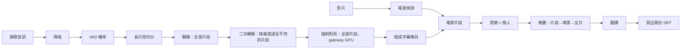
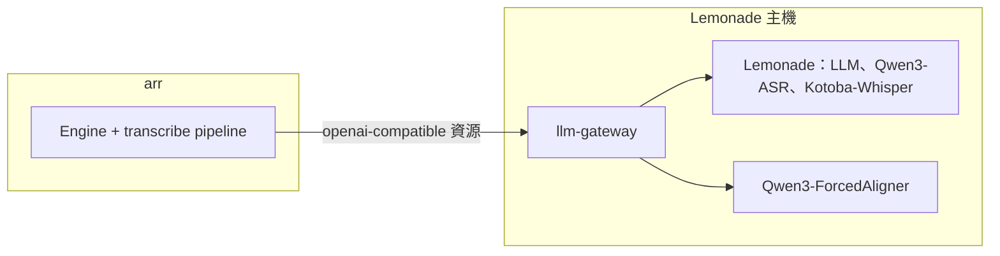

# transcribe：長片段轉錄與場景單位處理（入口文件）

狀態：已核可（2026-10-18）。本頁回答：transcribe pipeline 要如何改成「長片段轉錄加強制對齊、以場景為單位潤飾與摘要」，關鍵決策是什麼，細節在哪裡。本主題修訂已核可的 [transcribe pipeline](../../stable/transcribe-pipeline/README.md)，取代範圍見下方「與 stable 的關係」。

## 目標

- 字幕的文字更準確：轉錄模型聽約 30 秒的長片段，有足夠的語境；轉錄降級或語言不符的片段由第二個轉錄模型補救。
- 字幕看得出是對話還是獨白：換人說話時以對話破折號標出，可用參數關閉。
- 摘要說明演員在做什麼、情緒與所處場景；全片摘要依主題組織，不寫成流水帳。
- 一小時的影片以 3 小時處理完為目標，但不為了速度犧牲準確度。

## 關鍵決策

| 主題 | 結論 | 詳見 |
|---|---|---|
| 轉錄單位與時間 | 整條時間軸切成連續、約 30 秒的長片段，片段之間沒有空隙；Qwen3-ASR 轉錄後以 Qwen3-ForcedAligner 取得字詞時間，再由程式組成約 6 秒以內的字幕條目；取消 VAD-B 與補掃 | [ADR-051](adr/ADR-051-long-chunks-and-forced-alignment.md) |
| 二次轉錄 | 首次轉錄降級、或文字語言與影片不符的片段，以第二個轉錄模型在固定語言下再轉錄一次；預設開啟，預設模型為 Kotoba-Whisper（日語），run 語言不在清單內時略過 | [ADR-073](adr/ADR-073-whisper-second-pass.md)、[ADR-075](adr/ADR-075-second-pass-default-on-with-kotoba.md) |
| 對齊的執行位置 | Lemonade 主機的 llm-gateway 以 GPU 執行對齊，經 OpenAI 相容的音訊轉錄端點提供；Engine 資源的上游改為 gateway；Engine 映像不加入 Python | [ADR-056](adr/ADR-056-alignment-on-gateway-gpu.md) |
| 處理單位 | 以畫面變化切出場景，場景再切成約 12 秒的場景片段；潤飾、摘要、翻譯以場景片段為單位 | [ADR-052](adr/ADR-052-scenes-as-llm-units.md) |
| 潤飾與換人 | 潤飾附畫面，並以「換人資料」標出新說話者的開頭；SRT 是否畫出破折號由參數決定，兩份 SRT 一致；刪除畫面核對階段 | [ADR-053](adr/ADR-053-polish-with-frames-and-speaker-turns.md) |
| 摘要與翻譯 | 片段、場景、全片三層英文摘要，全片摘要依主題組織；翻譯附場景摘要與前文，不附角色表 | [ADR-054](adr/ADR-054-scene-summaries-and-translation-context.md)、[ADR-074](adr/ADR-074-remove-character-table.md) |
| 摘要的回答開頭、用詞與降級 | 場景層摘要在 thinking 關閉時以預填固定回答開頭；片段摘要稱呼自己為「片段」；被截斷的摘要照常保存並告知下一層；沒有素材的片段與場景直接降級，欄位固定的層保存時只取欄位區塊（[量測報告](summary-leak-experiment-report.md)） | [ADR-077](adr/ADR-077-scene-summary-answer-opening.md)、[ADR-078](adr/ADR-078-segment-summary-wording.md)、[ADR-079](adr/ADR-079-truncated-summary-is-kept-and-flagged.md)、[ADR-080](adr/ADR-080-summary-degradation-conditions.md)、[ADR-082](adr/ADR-082-truncated-with-no-complete-field-is-kept.md)、[ADR-081](adr/ADR-081-default-summary-prompts-adopt-measured-structure.md)（預設提示採用量測驗證過的結構，[原文](run38-summary-prompts-reference.md)） |
| thinking、生成上限與止損 | thinking 預設關閉；開啟時用專屬的取樣參數與推理額度；轉錄請求帶生成上限；截斷不拆批，同一原因連續失敗時及早停止 | [ADR-058](adr/ADR-058-measured-defaults.md)（量測後核定的預設值）、[ADR-055](adr/ADR-055-thinking-policy-and-early-stop.md)、[ADR-057](adr/ADR-057-asr-endpoints-and-alignment-word-timing.md)（上限只適用 chat 端點；對齊回應固定含字詞時間） |
| 小模型的特徵與對策 | 轉錄模型與對話模型的行為特徵、為此做的工作項、放棄的做法，彙整成一份文件 | [小模型的行為特徵與對應的工作項](small-llm-traits-and-countermeasures.md) |

## 處理階段

## 元件

## 與 stable 的關係

- 取代：[ADR-038](../../stable/transcribe-pipeline/adr/ADR-038-segment-model-and-stage-invariants.md) 決策 1 至 5（不變式「條目在組成後數量與時間固定」保留並移到 ADR-051）、[ADR-044](../../stable/transcribe-pipeline/adr/ADR-044-asr-coverage-sweep.md)、[ADR-049](../../stable/transcribe-pipeline/adr/ADR-049-batches-with-read-only-context.md)、[ADR-050](../../stable/transcribe-pipeline/adr/ADR-050-subtitle-length-and-merge.md) 決策 2 至 4。
- 在本主題內取代：[03](03-options.md) A 的推薦（A1 改為在 gateway 上的 A2），由 ADR-056 說明；ADR-054 的決策 4、5 與決策 6 的角色表由 ADR-074 取代；ADR-073 的決策 2、7 由 ADR-075 取代。
- 修訂：入口文件的範圍外「說話者辨識」改為「依文字與畫面標出換人；不做聲紋辨識、不標出是誰」。
- 保留：ADR-036、037、039、040、042、046（降噪只供 VAD，轉錄取原始音訊）。
- 作廢：[WI-1450](../../stable/transcribe-pipeline/work-items/WI-1450-segmentation-defaults-for-six-seconds.md)（由 WI-1455 取代）。

## 文件

| 文件 | 回答的問題 | 狀態 |
|---|---|---|
| [01 需求](01-requirements.md) | 目標、範圍、成功指標、假設與待確認問題 | 已核可（2026-10-16） |
| [02 現況](02-current-state.md) | run 8 的量測與 thinking 實驗告訴了我們什麼 | 已核可 |
| [03 選項](03-options.md) | 對齊、場景偵測、換人、核對各有哪些做法，選哪個 | 已核可；A 的推薦由 ADR-056 取代 |
| [04 部署](04-deployment.md) | 各主機與服務要多提供什麼 | 已核可（2026-10-16） |
| [05 IPC](05-ipc.md) | 與模型服務、ffmpeg 之間的契約 | 已核可（2026-10-16） |
| [06 資料模型](06-data-model.md) | 新增哪些實體，如何與舊資料並存 | 已核可（2026-10-16） |
| [07 非功能與風險](07-nfr-risks.md) | 容量、處理時間目標、失敗模式與風險 | 已核可（2026-10-16）；數字為實測推算 |
| [小模型的行為特徵與對應的工作項](small-llm-traits-and-countermeasures.md) | 轉錄模型與對話模型有哪些行為特徵，各以哪些工作項對付，哪些做法已放棄 | 已核可（2026-10-18） |
| [工作項總覽](work-items/README.md) | 要交給 tdd-coder 的工作與順序 | 已核可 |

### 處理 LLM 相關問題時

任何與 LLM 行為有關的問題（轉錄模型或對話模型的失控生成、重複、格式不符、語言錯誤、幻覺、外洩、降級、重試與止損規則、提示詞、取樣參數、換模型或換服務），在分析或動手前先讀[小模型的行為特徵與對應的工作項](small-llm-traits-and-countermeasures.md)，避免重走已放棄的做法；處理完成後，若出現新的特徵、新的對策或新放棄的做法，同步更新該文件（在 draft 開修訂稿，核可後晉升）。
