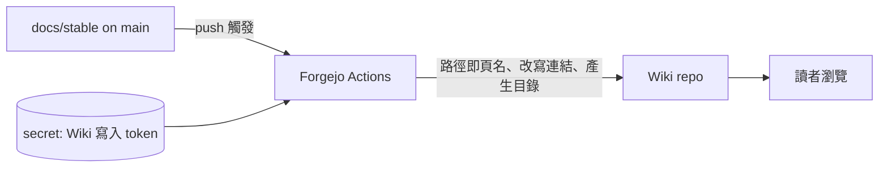

# wiki-mirror：Forgejo Wiki 作為 stable 文件映像

本主題回答：`docs/stable/` 如何自動呈現在 Forgejo Wiki，而 Wiki 不成為第二份事實來源。狀態：已核可。

## 目標與範圍

- 範圍內：`docs/stable/` 合併進 `main` 後，Wiki 自動更新為其映像，文件間連結可用，並有首頁目錄與側邊欄。
- 範圍外：Wiki 的人工編輯、`docs/draft/` 的呈現、文件內容本身的改寫。

## 關鍵決策

| 項目 | 結論 | 細節 |
|---|---|---|
| Wiki 的角色 | `docs/stable/` 的唯讀映像，單向同步 | [#1](adr/1-wiki-is-readonly-mirror.md)（已核可） |
| 頁面對應 | 路徑即頁名，可逆、無碰撞 | [#6](adr/6-mirror-mapping-links-deletion-credential.md)（已核可） |
| 連結 | 改寫成 Wiki 連結，儲存庫內其他檔案指向 `main` | 同上 |
| 刪除 | 每次完整重新產生，刪除與改名同步反映 | 同上 |
| 憑證 | 專用 secret，最小權限，由使用者提供 | 同上 |
| 實作 | Forgejo Actions 工作流，交給 tdd-coder | [工作項](work-items/README.md)（已核可，待使用者提供憑證） |

## 元件關係

## 待確認問題

- Wiki 功能是否已啟用？Forgejo 對頁名中路徑分隔的支援情形為何？決定頁名規則的最終形式；由 [#2](work-items/2-sync-stable-to-wiki.md) 的先決確認回報。
- Actions 內建 token 是否能寫入 Wiki？不能時，使用者須提供專用 token。
- 指向其他儲存庫的連結（例如 `runline-digest-rss`）是否要補上對應網址？目前的處理是保留文字、移除連結。
